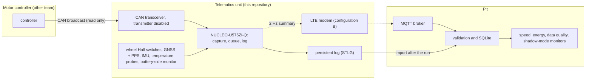

# Shell Eco-marathon Vehicle Telematics

Telematics for our Shell Eco-marathon battery-electric vehicle: the unit that measures the vehicle (wheel speed, GNSS, IMU, temperatures), receives the motor controller's data, logs everything on board, sends a summary to the pit, and the pit tools that turn the logs into speed, energy and data-quality reports. The goal is to know where the energy goes and to give the driver and the team evidence for lower energy per attempt.

**Scope (v0.7).** The motor controller is built by another team. This repository's deliverable is the telematics unit and the pit software. Our earlier motor-controller work (controller core, STM32G474 port, power-stage schematic) is kept as deferred controller development and is not on the telematics path ([`docs/scope.yaml`](docs/scope.yaml), [`docs/generated/scope.md`](docs/generated/scope.md)).

**The unit only listens.** It sends nothing to the controller: no torque request, no arming, no fault reset, no configuration change, and it takes no part in protection or precharge. Optimisation is offline analysis or advice to the driver; there is no automatic speed control.

New to the project: read section 1, then pick the next step in section 6. Team workflow: [`CONTRIBUTING.md`](CONTRIBUTING.md).

## 1. Architecture and the controller boundary



The arrow from the controller is the only connection to it, and it points one way. What crosses it is whatever the controller already broadcasts; what we ask the controller team for is in [`docs/CONTROLLER_INTERFACE_REQUEST.md`](docs/CONTROLLER_INTERFACE_REQUEST.md). Until they answer, our own CAN message set (`semmc`, [`protocol/`](protocol/README.md)) is a simulation fixture for tests, not an interface anyone has agreed to.

Every value becomes a measurement with its source, signal identity and unit, receive time, sample time when the source gives one (never invented), timestamp uncertainty, the source's own sequence counter when it has one, validity and provenance ([`host/telematics/measurement.py`](host/telematics/measurement.py), [`host/telematics/signals.py`](host/telematics/signals.py)). A missing or stale value is reported as missing or stale, never as zero.

## 2. Status

| Part | Implemented and tested on a computer | Simulated only | Run on hardware |
|---|---|---|---|
| Receive-only node: measurements, controller adapters (semmc fixture with CRC and sequence; DBC with a unit-checked mapping), bounded log queue, live summary, bounded uplink backlog | yes ([`host/telematics/`](host/README.md)) | the external controller is a Python stand-in ([`host/telematics/sim_vehicle.py`](host/telematics/sim_vehicle.py)) | no |
| Firmware for the NUCLEO-U575ZI-Q: wheel capture (1 µs, 64-bit across timer overflow), no edge never read as 0, stuck or disconnected sensors flagged against the other wheels, bounded queue, STLG log on a W25Q NOR (internal flash when none answers) with sparse logging once only a reserve is left, restart reasons, counters; FDCAN1 receive-only in bus-monitoring mode; IMU and TMP117 on I2C | portable code: unit tests under sanitizers, byte-for-byte equal to the Python reference; images link and their structure is checked ([`telematics/firmware/`](telematics/firmware/README.md)) | the host simulator runs the firmware's own code against scripted inputs | **no: never flashed; no connection bench-verified** |
| Log import, pit validation (`sem.telemetry.v4`), SQLite with idempotent re-import, speed and distance from edge timing, energy from valid aligned V x I at two boundaries, data-quality report | yes ([`host/pit/`](host/README.md), [`tools/telematics_import.py`](tools/telematics_import.py)) | | no vehicle data yet |
| End-to-end demonstration: controller silence, invalid frames, a missing signal, a storage stall, a broker outage, a telematics restart | 9 checks pass through a real local Mosquitto broker ([`docs/generated/telematics_demo/summary.md`](docs/generated/telematics_demo/summary.md)) | all inputs simulated | no |
| Shadow-mode monitors R3v and CSIA2 | yes, on pit data, with relationships disabled when an input is missing | | no |
| GNSS + PPS, LTE modem, on-target uplink | host model only | | no |

**Bench-tested:** nothing yet. The first physical test is the bench package of section 6, step 2.

## 3. Commands

Tested on Linux x86-64 (Ubuntu 24.04, gcc 13, CMake 3.28, Ninja, Python 3.13; `arm-none-eabi-gcc` 13.2 for the target; Mosquitto 2.0.18 for the broker run). None of them builds the motor controller.

```sh
python3 -m venv .venv && . .venv/bin/activate && pip install -r requirements.txt
python3 tools/fetch_csia.py                                   # pinned CSIA core (shadow-mode monitors)
python3 -m pytest -m "telematics or reference"                # the telematics delivery and reference suites
python3 tools/run_telematics_demo.py --out build/telematics_demo   # real broker; add --in-process without one
cmake -S telematics/firmware -B build-telematics -G Ninja && cmake --build build-telematics && ctest --test-dir build-telematics
cmake -S telematics/firmware -B build-u575 -G Ninja -DCMAKE_BUILD_TYPE=MinSizeRel \
      -DCMAKE_TOOLCHAIN_FILE=$PWD/telematics/firmware/cmake/arm-none-eabi-cortex-m33.cmake -DTM_TARGET_U575=ON
cmake --build build-u575                                      # tm_u575.elf/.bin/.hex and tm_u575_can.*
python3 tools/telematics_bench.py package --images build-u575 --out build/telematics_bench --rebuild   # bench package
python3 tools/telematics_import.py dump.bin --db pit.sqlite --out build/bench_import   # a log read from the board
```

Flashing and reading the log back: [`telematics/firmware/BENCH.md`](telematics/firmware/BENCH.md) section 5 (commands) and the bench package it builds (section 2). The deferred controller work has its own suite and CI job (`python3 -m pytest -m controller`, [`firmware/README.md`](firmware/README.md)); the legacy supervised simulations run only with `--legacy-supervised`.

## 4. Bill of materials

Telematics only, summed from its own lines, every price a dated search snapshot or a stated allowance; nothing ordered ([`docs/TELEMATICS_BOM.md`](docs/TELEMATICS_BOM.md)):

| Configuration | Contents | Range |
|---|---|---|
| bench | USB-powered first bench: exactly the parts the firmware drives (NUCLEO-U575ZI-Q, W25Q128JV NOR on an adapter, ISM330DHCX IMU, TMP117, CAN Pal transceiver), cables, breadboard, jumpers | $97.68 to $117.74 |
| A | bench plus vehicle logging: wheel sensors and magnets, GNSS with antenna, two more TMP117, CAN cable, sealed connectors, harness, enclosure, spares, shipping, tax; the vehicle supply lines (DC-DC, TVS, fuse, reverse diode) are blocked placeholders | $462.73 to $666.45 |
| B | A plus an LTE modem board and antenna | $505.72 to $870.12; with the optional display $550.67 to $919.56 |
| Recurring (B) | IoT SIM: $3 once, then about $2 to $65 a month depending on the running hours | |

Battery: 48 V nominal, 10 Ah, as the vehicle team reports it. Its maximum voltage is unknown, so no supply-protection part is chosen and **the vehicle power connection is blocked** (the one TVS and DC-DC pair checked is rejected: its clamp is above the converter's input maximum); the bench runs from USB. Parts without a firmware driver (microSD, DS18B20 probes) are options in no total. Estimates are not quotes.

## 5. Connection guide (bench, NUCLEO-U575ZI-Q)

| Signal | Pin | Nucleo position |
|---|---|---|
| wheel 0 / 1 / 2 (Hall switch outputs, 3.3 V) | PA3 / PA2 / PA0 (TIM2) | Arduino A0 / A1 / not needed on the bench |
| CAN RX / TX to the CAN Pal, its silent pin at 3.3 V | PD0 / PD1 (FDCAN1) | to locate: Zio, morpho or the CAN FD header |
| IMU and temperature sensors (I2C) | PB8 SCL / PB9 SDA | Arduino D15 / D14 |
| NOR flash (SPI) | PA5 / PA6 / PA7, CS PD14 | Arduino D13 / D12 / D11 / D10 |
| Console | USART1 PA9 / PA10 | ST-LINK USB |

Every row is taken from ST's board files and is **not verified on a board**; levels, solder bridges and the electrical checks before any vehicle bus are in [`telematics/firmware/BENCH.md`](telematics/firmware/BENCH.md) sections 4 and 7.

## 6. Next steps (critical path)

1. **Interface agreement and telemetry hardware selection.** Send [`docs/CONTROLLER_INTERFACE_REQUEST.md`](docs/CONTROLLER_INTERFACE_REQUEST.md) to the controller team; quote the bench parts; the vehicle supply waits for the battery's maximum voltage.
2. **Embedded acquisition and local log.** The next physical test is the bench package (`python3 tools/telematics_bench.py package`, also a CI artifact): steps B0 to B12 of [`telematics/firmware/BENCH.md`](telematics/firmware/BENCH.md), from flashing `tm_u575.bin` and a 100 Hz square wave on PA3 to the stuck-sensor checks (B6), 75 min across the timer overflow on the NOR (B7) and CAN receive (B11), each written on the package's blank results form.
3. **Bench integration.** The CAN receive image against a USB-CAN adapter, then the controller team's recording through the DBC adapter, then the electrical checks E1 to E6.
4. **Remote uplink.** The modem on the target (configuration B).
5. **Vehicle data and analysis.** Energy at both boundaries, coast-down, the shadow monitors on measured data.

Controller items (power-stage parts, precharge, footprints, the current loop) do not block any of these; they belong to the deferred controller development. The full plan and the open items: [`docs/IMPLEMENTATION_PLAN.md`](docs/IMPLEMENTATION_PLAN.md), [`docs/BLOCKERS.md`](docs/BLOCKERS.md).

## Documentation

Index of every document, with current and historical ones labelled: [`docs/README.md`](docs/README.md). Interfaces: [`docs/ICD.md`](docs/ICD.md) (the telematics unit's interfaces), [`docs/TELEMETRY_INTEGRATION.md`](docs/TELEMETRY_INTEGRATION.md) (signals, energy, shadow mode), [`docs/TELEMETRY_EMBEDDED_PORT.md`](docs/TELEMETRY_EMBEDDED_PORT.md) (firmware status by function). Energy methods and the worked example: [`docs/ENERGY_METHODS.md`](docs/ENERGY_METHODS.md). Verification record: [`docs/VERIFICATION_REPORT.md`](docs/VERIFICATION_REPORT.md). All files by folder: [`docs/FILE_INDEX.md`](docs/FILE_INDEX.md).
