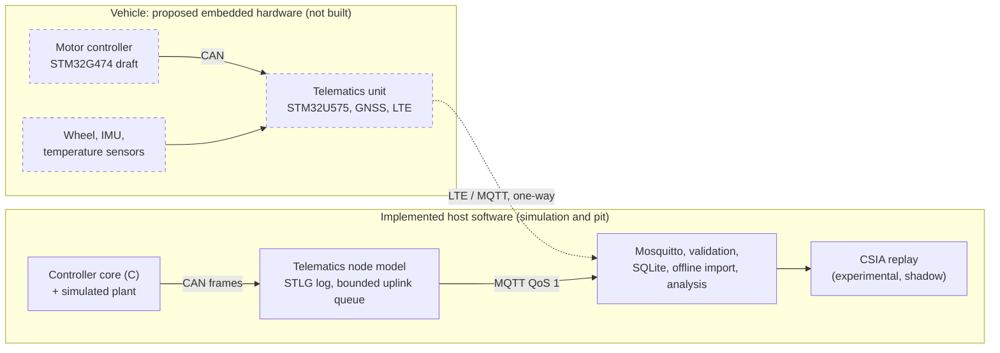

# Shell Eco-marathon Vehicle Electronics

This project connects a purpose-built motor controller for a Shell Eco-marathon battery-electric vehicle with telemetry, local data logging and energy-consumption analysis. The aim is lower energy per attempt within the event's rules, on a budget of about $500 to $1,000, with the vehicle team doing assembly and testing. The repository is `sem-motor-controller`; the motor controller remains its core.

## System

* **Motor controller:** runs the motor (field-oriented control, protection, state machine, torque arbitration) and publishes its measurements and state on CAN. Portable C core; target hardware is a draft STM32G474 design.
* **Telematics:** collects controller, battery and sensor data (wheel speed, GNSS, IMU, temperatures), timestamps it, runs the supervisory task and sends a 2 Hz summary over LTE/MQTT. Proposed unit: STM32U575.
* **Local logging:** every CAN frame and sensor sample goes to a block log (STLG) on the vehicle, so data survive without cellular coverage and are imported after the run.
* **Pit-side tools:** an MQTT broker, a validating ingestion service and SQLite, offline log import, and the energy and strategy analyses.
* **CSIA:** experimental sensor-consistency diagnostics, pit-side or replay shadow mode only. Version 2 did not meet its pre-registered superiority criterion against the simpler majority-vote monitor ([`docs/csia/EVALUATION_RESULTS_v2.md`](docs/csia/EVALUATION_RESULTS_v2.md)).



Dashed boxes are proposed hardware; solid boxes run today on a host computer. LTE, MQTT, the database and CSIA are not needed to drive: protection, the brake override and manual driving stay local to the controller.

## Current status

* **Runs in host simulation:** the controller core against a simulated plant, and the telemetry chain (node model, local log, MQTT through a real local Mosquitto broker, pit validation and storage, offline import, CSIA replay). Checked on GitHub-hosted CI.
* **Embedded work remaining:** the STM32G4 platform layer and precharge logic for the controller; all STM32U575 telematics firmware ([`docs/TELEMETRY_EMBEDDED_PORT.md`](docs/TELEMETRY_EMBEDDED_PORT.md)).
* **Blocking hardware selection:** motor parameters; battery and BMS datasheets (only 48 V nominal and 10 Ah are team-reported, [`docs/BATTERY.md`](docs/BATTERY.md)); the vehicle CAN bus; connectors; the event.
* **Hardware:** none built, energised or tested. The controller schematic is a draft without layout; nothing has been ordered.

Detail: [`docs/STATUS.md`](docs/STATUS.md) and [`docs/VERIFICATION_REPORT.md`](docs/VERIFICATION_REPORT.md).

## Budget

<!-- procurement-table:begin -->
Telemetry procurement, generated from [`hardware/bom/telemetry_procurement.yaml`](hardware/bom/telemetry_procurement.yaml) (updated 2026-10-16). Requirements, candidates and what blocks each line: [`docs/PROCUREMENT.md`](docs/PROCUREMENT.md). The motor-controller BOM is separate: [`hardware/bom/README.md`](hardware/bom/README.md).

| Item | Qty | Unit cost (USD) | Total (USD) | Status |
|---|---|---|---|---|
| **Development equipment (bench work, not installed in the vehicle)** | | | | |
| NUCLEO-U575ZI-Q development board | 1 | TBD | TBD | Candidate |
| **Installed vehicle hardware** | | | | |
| Telematics PCB fabrication and assembly | TBD | TBD | TBD | Blocked |
| Wheel-speed Hall sensor | TBD | TBD | TBD | Blocked |
| Wheel magnets and mounting hardware | TBD | TBD | TBD | Blocked |
| 6-axis IMU | 1 | TBD | TBD | Candidate |
| Temperature sensors/probes | TBD | TBD | TBD | Candidate |
| GNSS receiver/module, if not included in the PCB assembly | 1 | TBD | TBD | Blocked |
| Active GNSS antenna | 1 | TBD | TBD | Blocked |
| LTE modem, if not included in the PCB assembly | 1 | TBD | TBD | Blocked |
| LTE antenna | 1 | TBD | TBD | Blocked |
| Protected DC-DC power supply, if not included in the PCB assembly | 1 | TBD | TBD | Blocked |
| CAN transceiver/interface, if not included in the PCB assembly | 1 | TBD | TBD | Blocked |
| Connectors and wiring | TBD | TBD | TBD | Blocked |
| Driver display | 1 | TBD | TBD | Blocked |
| Optional steering-angle sensor | 1 | TBD | TBD | Blocked |
| **Recurring connectivity** | | | | |
| SIM card and data plan | 1 | TBD | TBD | Blocked |
| **Shipping and tax** | | | | |
| Shipping and tax on the lines above | TBD | TBD | TBD | Blocked |
| **Contingency** | | | | |
| Contingency | TBD | TBD | TBD | Blocked |

* Known priced subtotal: **none**: none of the 18 lines has a dated price.
* Unpriced lines: **18** (shown as TBD).
* Estimated total: **not stated**. It needs a dated price for every counted line and an agreed scope (which lines, how many units, shipping and tax, contingency).
* Budget: the project budget is about $500 to $1,000. Whether the telemetry lines share it with the motor-controller BOM ([`docs/BUDGET.md`](docs/BUDGET.md)) is **unconfirmed**.
* Status: Candidate 3, Selected 0, Ordered 0, Received 0, Blocked 15. Nothing has been ordered.
* A separate battery for the driver display is not an approved purchase: Article 57i allows built-in batteries only in unmodified, self-contained display or communication devices, and Article 57b allows no accessory battery on a Battery Electric vehicle.
<!-- procurement-table:end -->

## Getting started

Linux with gcc, cmake, ninja and Python 3.11 or newer:

```sh
python3 -m venv .venv && . .venv/bin/activate && pip install -r requirements.txt
python3 tools/fetch_csia.py                                     # pinned CSIA core into .deps/
cmake -S firmware -B build -G Ninja && cmake --build build && ctest --test-dir build
python3 -m pytest                                               # MQTT tests skip without a broker
python3 tools/run_host_demo.py --out build/host_demo            # simulated uplink
python3 tools/run_mqtt_demo.py --out build/mqtt_demo            # real broker: docs/MQTT_SETUP.md
```

Broker setup: [`docs/MQTT_SETUP.md`](docs/MQTT_SETUP.md). Every check in one command, with a written record: `python3 tools/verify_all.py --out build/verify` ([`docs/VERIFICATION_REPORT.md`](docs/VERIFICATION_REPORT.md)).

## Team inputs

* What is needed from the team, in priority order: [`docs/INPUT_SHEET.md`](docs/INPUT_SHEET.md) (authoritative).
* Interfaces (CAN, timing, log, MQTT): [`docs/ICD.md`](docs/ICD.md).
* Telemetry signals and the integration plan: [`docs/TELEMETRY_INTEGRATION.md`](docs/TELEMETRY_INTEGRATION.md); candidate parts and their sources: [`docs/TELEMETRY_CANDIDATES.md`](docs/TELEMETRY_CANDIDATES.md).
* Architecture: [`docs/COMBINED_ARCHITECTURE.md`](docs/COMBINED_ARCHITECTURE.md), [`docs/HARDWARE_ARCHITECTURE.md`](docs/HARDWARE_ARCHITECTURE.md).
* Hardware: [`hardware/bom/README.md`](hardware/bom/README.md), [`hardware/review/CONSISTENCY_CHECK.md`](hardware/review/CONSISTENCY_CHECK.md), [`hardware/bringup/BENCH_BRINGUP_CHECKLIST.md`](hardware/bringup/BENCH_BRINGUP_CHECKLIST.md).
* Rules read and their consequences: [`docs/RULES_COMPLIANCE.md`](docs/RULES_COMPLIANCE.md). Energy methods: [`docs/ENERGY_METHODS.md`](docs/ENERGY_METHODS.md). Mathematics: [`docs/MATH_SPEC.md`](docs/MATH_SPEC.md).
