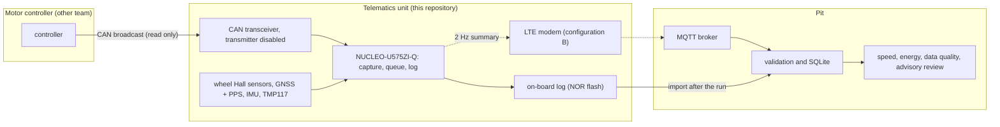

# Shell Eco-marathon Vehicle Telemetry

Telemetry for our Shell Eco-marathon battery-electric vehicle. A telematics unit on the vehicle measures wheel speed, position, acceleration and temperatures, receives the motor controller's broadcast data, and logs everything on board. The pit software turns those logs into speed, distance, energy and data-quality reports, so the team can see where the energy goes and lower the energy used per attempt.

**This repository implements vehicle telemetry and evidence analysis. It has no propulsion authority. CSIA integration is shadow/advisory only.**

**The unit only listens.** It sends nothing to the motor controller: no torque request, no arming, no fault reset, no configuration change, and it takes no part in protection or precharge. Energy optimisation is offline analysis or advice to the driver; there is no automatic speed control. Tests enforce this boundary ([`tests/telematics/test_receive_only_boundary.py`](tests/telematics/test_receive_only_boundary.py)).

The motor controller is built by another team. Our earlier controller work is kept as deferred controller development ([`firmware/README.md`](firmware/README.md)) and is not on the telemetry path ([`docs/scope.yaml`](docs/scope.yaml)).

| | |
|---|---|
| **Hardware** | NUCLEO-U575ZI-Q development board (STM32U575) with wheel Hall sensors, GNSS with PPS, an IMU, TMP117 temperature sensors, a CAN transceiver held silent and a 16 MiB NOR flash log |
| **Firmware** | C, in [`telematics/firmware/`](telematics/firmware/README.md): wheel capture, on-board log, receive-only CAN, sensors and a USB console |
| **Pit software** | Python, in [`host/`](host/README.md) and [`tools/`](tools/README.md): log import, SQLite database, speed, energy and data-quality reports, advisory review |
| **Cost** | $97.68 to $117.74 for the bench kit, $462.73 to $666.45 for the vehicle unit, $505.72 to $870.12 with the LTE uplink |
| **Status** | Software and firmware tested on computers; nothing has run on a board or on the vehicle yet |
| **Next step** | The minimal USB bench, which waits on two ST documents (section 6) |

## 1. System overview



1. **On the vehicle**, the NUCLEO timestamps every wheel edge, polls the IMU and the temperature sensors, and receives the controller's CAN frames with its transmitter disabled. Every record goes through a bounded queue into the on-board log.
2. **After a run**, the log is read out over USB and imported into the pit database. With configuration B, the unit also sends a 2 Hz summary over LTE to an MQTT broker in the pit during the run (so far in the host model only).
3. **At the pit**, every value is checked before it is used. A missing or stale value is reported as missing or stale, never as zero, and every conclusion links back to the logged data it rests on.

The arrow from the controller is the only connection to it, and it points one way. What crosses it is whatever the controller already broadcasts. What we need from the controller team is listed in [`docs/CONTROLLER_INTERFACE_REQUEST.md`](docs/CONTROLLER_INTERFACE_REQUEST.md). Until they answer, our own CAN message set (`semmc`, [`protocol/`](protocol/README.md)) is a simulation fixture for tests, not an agreed interface.

## 2. Firmware

The firmware runs on the NUCLEO-U575ZI-Q and lives in [`telematics/firmware/`](telematics/firmware/README.md). Interrupts only capture data; everything else runs in the main loop, nothing waits, and every dropped record is counted.

| Function | Implementation |
|---|---|
| Wheel speed | TIM2 input capture on PA3, PA2 and PA0, 1 µs timestamps extended to 64 bits across timer overflow. No edges means unknown, never 0 m/s; a stuck or disconnected sensor is flagged against the wheels that are moving |
| On-board log | STLG records on a W25Q128JV NOR flash (16 MiB), or internal flash bank 2 when no NOR answers; sparse logging once only a reserve is left |
| Controller data | FDCAN1 in bus-monitoring mode: receive only, no acknowledgement, no transmission |
| Sensors | ISM330DHCX IMU and up to four TMP117 temperature sensors on I2C1 |
| Diagnostics | Restart cause, boot count and a counter for every drop; a USB console whose `DUMP` command reads the log out |

Two images are built: `tm_u575` (wheels, log, sensors, console) and `tm_u575_can`, which adds CAN reception.

**Status: never flashed; no connection bench-verified.** The portable code passes its unit tests under sanitizers and matches the Python reference byte for byte. The register-level code follows ST's HAL and has been checked against the board manual UM2861 Rev 10 and the errata ES0499 Rev 12. The checks that need the STM32U575 data sheet and reference manual are still open ([`telematics/bench/DOCUMENT_CHECKS_RECORD.md`](telematics/bench/DOCUMENT_CHECKS_RECORD.md)).

**Bench candidate:** commit `ca74302`, CI artifact `telematics-bench-minimal` (ID 12160820013), `tm_u575.bin` SHA-256 `1a758fbea520b05ff68b2cba50a0d9502d492f5f25dfb815cd769cc932f48e12`. Flash that artifact only; [`telematics/bench/HANDOFF_MINIMAL.md`](telematics/bench/HANDOFF_MINIMAL.md) explains why.

Build and test (Linux, gcc 13, CMake 3.28, Ninja, `arm-none-eabi-gcc` 13.2):

```sh
cmake -S telematics/firmware -B build-telematics -G Ninja && cmake --build build-telematics
ctest --test-dir build-telematics --output-on-failure            # unit tests under ASan and UBSan
cmake -S telematics/firmware -B build-u575 -G Ninja -DCMAKE_BUILD_TYPE=MinSizeRel \
      -DCMAKE_TOOLCHAIN_FILE=$PWD/telematics/firmware/cmake/arm-none-eabi-cortex-m33.cmake -DTM_TARGET_U575=ON
cmake --build build-u575                                         # tm_u575.elf/.bin/.hex and tm_u575_can.*
```

Bench connections:

| Signal | MCU pin | Board position |
|---|---|---|
| Wheel 0 / 1 / 2 (Hall sensor outputs, 3.3 V) | PA3 / PA2 / PA0 (TIM2) | Arduino A0 (CN9 pin 1) / A1 (CN9 pin 3) / not needed on the bench |
| CAN RX / TX to the CAN Pal, its silent pin at 3.3 V | PD0 / PD1 (FDCAN1) | Zio CN9 pin 25 / pin 27 |
| IMU and temperature sensors (I2C) | PB8 SCL / PB9 SDA | Arduino D15 / D14 (CN7 pin 2 / pin 4) |
| NOR flash (SPI) | PA5 / PA6 / PA7, CS PD14 | Arduino D13 / D12 / D11 / D10 (CN7 pins 10 / 12 / 14 / 16) |
| Console | USART1 PA9 / PA10 | ST-LINK USB (CN1, Micro-B) |

Positions come from ST's board files and UM2861 Rev 10 (Tables 15 and 17) and are **not verified on a board**. Levels, solder bridges and the electrical checks before any vehicle bus: [`telematics/firmware/BENCH.md`](telematics/firmware/BENCH.md) sections 4 and 7. Status by function: [`docs/TELEMETRY_EMBEDDED_PORT.md`](docs/TELEMETRY_EMBEDDED_PORT.md).

## 3. Bill of materials

**Purchasing status:** nothing ordered. Estimates are not quotes: every price is a search snapshot from 2026-10-18 or a stated allowance, and each line needs a live quote and the team lead's approval before it is ordered.

| Stage | What it adds | Total with 0 to 10 % tax |
|---|---|---|
| Minimal bench | NUCLEO-U575ZI-Q, USB Micro-B cable, jumper wires | $31.10 to $41.87 |
| Full bench | W25Q128JV NOR on an adapter, ISM330DHCX IMU, TMP117, CAN Pal transceiver, cables, breadboard | $97.68 to $117.74 |
| Configuration A, vehicle unit | wheel sensors and magnets, GNSS with antenna, two more TMP117, CAN cable, sealed connectors, harness, enclosure, spares, shipping; the vehicle supply lines are placeholders | $462.73 to $666.45 |
| Configuration B, LTE uplink | LTE modem board and antenna | $505.72 to $870.12 |
| B with driver display | sunlight-readable display, advice only | $550.67 to $919.56 |

Equipment, if not owned: $85 to $180 (two USB-CAN adapters and a crimp tool); the bench also needs a signal generator, an oscilloscope and a multimeter from the lab. Configuration B adds a $3 SIM and $1.94 to $66.84 a month for data.

Battery: 48 V nominal, 10 Ah, as the vehicle team reports it. Its maximum charged voltage is not known, so no supply-protection part is chosen and **the vehicle power connection is blocked**; the bench runs from USB.

* Every line by stage, with the build plan: [`docs/TELEMETRY_BOM_PLAN.md`](docs/TELEMETRY_BOM_PLAN.md)
* Every line with its price source: [`docs/TELEMATICS_BOM.md`](docs/TELEMATICS_BOM.md), generated from [`hardware/telematics/bom.yaml`](hardware/telematics/bom.yaml)

## 4. Pit software

* **Import and storage.** [`tools/telematics_import.py`](tools/telematics_import.py) reads a log dump into SQLite; importing the same log twice changes nothing. Live messages (`sem.telemetry.v4`) are checked against their schema on arrival.
* **Speed, distance and energy.** Speed and distance come from wheel edge timing; energy comes from valid, time-aligned voltage and current at two measurement boundaries. Each run gets a data-quality report.
* **One contract per signal.** Source, unit, scaling, rate, timestamp and freshness are defined once ([`docs/TELEMETRY_SCHEMA.md`](docs/TELEMETRY_SCHEMA.md)). Every value gets one evidence state, and only VALID values are used.
* **Advisory review.** Sensors are cross-checked: wheel against GNSS, wheels against each other, the IMU against the wheel. A disagreement is reported with its candidate causes, never as a named fault, and every conclusion has a receipt of the data it rests on. CSIA and R3v run in shadow mode on pit data only.
* **Claims.** Every result carries a label: SIMULATED, HOST-TESTED, BENCH-TESTED, HIL-TESTED or VEHICLE-TESTED ([`docs/CLAIMS.md`](docs/CLAIMS.md)). Nothing is above HOST-TESTED today. The protocols that will raise them are in [`research/vehicle_validation/`](research/vehicle_validation/README.md).

## 5. Status

| Part | Tested on a computer | On hardware |
|---|---|---|
| Receive-only node and controller adapters (the `semmc` fixture and a DBC adapter) | yes; the external controller is simulated | no |
| Firmware for the NUCLEO-U575ZI-Q | unit tests under sanitizers; images build and link with reproducible hashes | no |
| Log import, pit database, speed, energy and data-quality reports | yes | no vehicle data yet |
| End-to-end demonstration: controller silence, invalid frames, a storage stall, a broker outage, a restart | 9 of 9 checks through a real Mosquitto broker, all inputs simulated | no |
| Evidence model and advisory review | yes; the four validation protocols pass their simulated pre-check | no |
| GNSS with PPS, LTE modem on the board | host model only | no |

**Bench-tested:** nothing yet. The first physical test is the minimal bench (section 6).

## 6. Next steps (critical path)

0. **Pre-flash documents.** Commit the STM32U575 data sheet DS13737 and reference manual RM0456 to `docs/reference/datasheets/`; the open firmware checks DC02 to DC09 are then answered from them.
1. **Minimal bench, USB power only.** One wheel input through the whole chain to a plot: [`telematics/bench/HANDOFF_MINIMAL.md`](telematics/bench/HANDOFF_MINIMAL.md).
2. **Full bench.** Steps B0 to B12 and the electrical checks E1 to E5: [`telematics/firmware/BENCH.md`](telematics/firmware/BENCH.md).
3. **Controller interface, in parallel from now.** Send [`docs/CONTROLLER_INTERFACE_REQUEST.md`](docs/CONTROLLER_INTERFACE_REQUEST.md) to the controller team and decode their recording.
4. **Vehicle unit, configuration A.** Needs the pack's maximum voltage and the wheel geometry from the vehicle team.
5. **First vehicle run, receive-only.** After E1 to E6 and with the controller team's agreement.
6. **LTE uplink, configuration B.** Once the event and its country are known.

Owners, checklists and the evidence each stage returns: [`docs/TELEMETRY_BOM_PLAN.md`](docs/TELEMETRY_BOM_PLAN.md) section 8. Engineering plan: [`docs/IMPLEMENTATION_PLAN.md`](docs/IMPLEMENTATION_PLAN.md); open items: [`docs/BLOCKERS.md`](docs/BLOCKERS.md). Controller items (power-stage parts, precharge, footprints, the current loop) do not block any of these; they belong to the deferred controller development.

## 7. Working on the repository

Team workflow: [`CONTRIBUTING.md`](CONTRIBUTING.md). Tested on Ubuntu 24.04 with Python 3.13 and Mosquitto 2.0.18. None of these commands builds the motor controller.

```sh
python3 -m venv .venv && . .venv/bin/activate && pip install -r requirements.txt
python3 tools/fetch_csia.py                                     # pinned CSIA core for the shadow monitors
python3 -m pytest -m "telematics or reference"                  # this delivery's test suites
python3 tools/run_telematics_demo.py --out build/telematics_demo   # end to end through a real broker; --in-process without one
python3 tools/telematics_bench.py package --minimal --images build-u575 --host-build build-telematics \
        --out build/telematics_bench_minimal --rebuild         # minimal bench package
python3 tools/telematics_import.py dump.bin --db pit.sqlite --out build/bench_import   # a log read from the board
python3 tools/run_bench_chain.py --out build/bench_chain         # pulse to log to database to plot
python3 tools/claims.py --check                                  # every claim's label against its evidence
```

| Folder | Contents |
|---|---|
| [`telematics/firmware/`](telematics/firmware/README.md) | Firmware for the NUCLEO-U575ZI-Q |
| [`telematics/bench/`](telematics/bench/bench.yaml) | Bench procedures, the minimal-bench handoff, document checks, results |
| [`host/`](host/README.md) | Receive-only node, measurements and adapters (`host/telematics/`), pit database and reports (`host/pit/`), advisory review (`host/assurance/`) |
| [`tools/`](tools/README.md) | Command-line tools |
| [`hardware/telematics/`](hardware/telematics/bom.yaml) | The telemetry BOM source |
| [`docs/`](docs/README.md) | Documentation, with an index |
| [`tests/`](tests/README.md) | Test suites: `-m "telematics or reference"` for this delivery, `-m controller` for the deferred controller |
| [`firmware/`](firmware/README.md), [`protocol/`](protocol/README.md) | Deferred controller development and the `semmc` simulation fixture |

## 8. Documentation

| For | Read |
|---|---|
| The BOM and the build plan | [`docs/TELEMETRY_BOM_PLAN.md`](docs/TELEMETRY_BOM_PLAN.md) |
| The minimal bench | [`telematics/bench/HANDOFF_MINIMAL.md`](telematics/bench/HANDOFF_MINIMAL.md) |
| Interfaces of the unit | [`docs/ICD.md`](docs/ICD.md) |
| Signals, energy and shadow mode | [`docs/TELEMETRY_INTEGRATION.md`](docs/TELEMETRY_INTEGRATION.md), [`docs/ENERGY_METHODS.md`](docs/ENERGY_METHODS.md) |
| Firmware status by function | [`docs/TELEMETRY_EMBEDDED_PORT.md`](docs/TELEMETRY_EMBEDDED_PORT.md) |
| Where the repository stands | [`docs/CURRENT_STATE.md`](docs/CURRENT_STATE.md), [`docs/VERIFICATION_REPORT.md`](docs/VERIFICATION_REPORT.md) |
| Every document, current and historical | [`docs/README.md`](docs/README.md), [`docs/FILE_INDEX.md`](docs/FILE_INDEX.md) |
