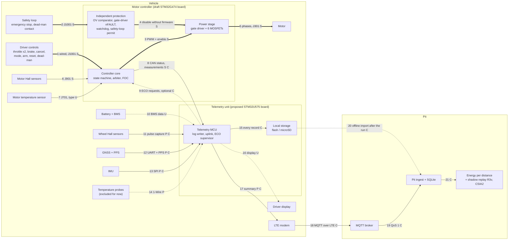
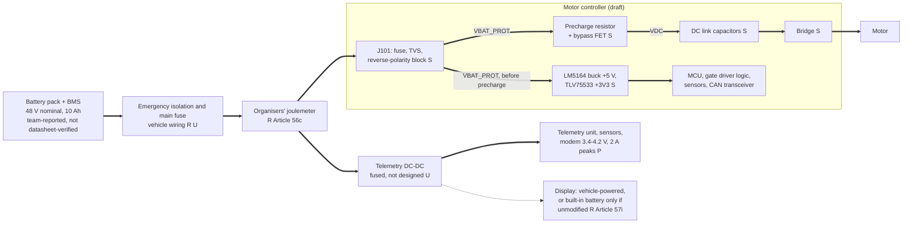
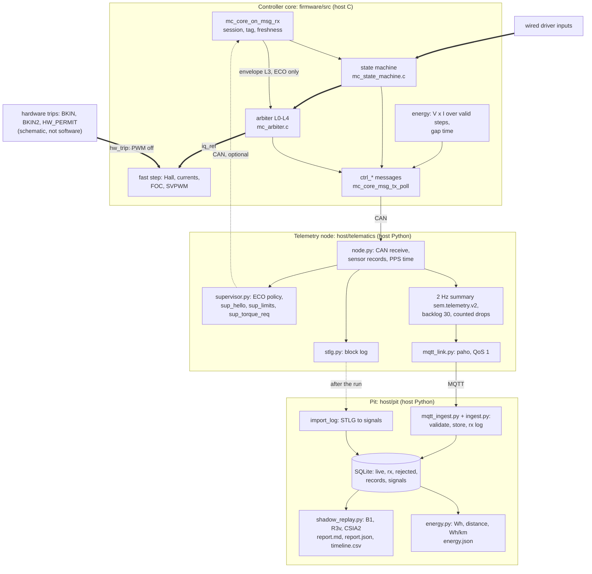

# Shell Eco-marathon Vehicle Electronics

Electronics and software for our Shell Eco-marathon battery-electric vehicle: a purpose-built motor controller, a telemetry unit with local logging, an LTE/MQTT link to the pit, and the pit tools that turn the logs into energy per distance. The goal is lower energy per attempt within the event rules. The motor controller is the core of this repository (`sem-motor-controller`).

**New to the project?** Read section A, pick an open task in [H. Priorities](#h-priorities), and start from the folder guide named for it in [G. Where to work](#g-where-to-work). Team workflow and review rules: [`CONTRIBUTING.md`](CONTRIBUTING.md).

**Project status.** Each part of the system has one of three statuses:

* **Host**: implemented and tested on a computer (the C controller core against a simulated motor and vehicle, the Python models, a real local MQTT broker), checked on every push by GitHub Actions.
* **Proposed**: designed or specified for the vehicle but not built. The embedded firmware for both microcontrollers is not written; the controller schematic is a draft without layout.
* **Physically tested**: nothing yet. No board exists, nothing has been energised, and no vehicle data has been recorded.

Contents: [A. What we are building](#a-what-we-are-building) · [B. Diagrams](#b-diagrams) · [C. Operating sequence](#c-operating-sequence) · [D. Mathematics](#d-mathematics) · [E. Budget](#e-budget) · [F. Quick start](#f-quick-start) · [G. Where to work](#g-where-to-work) · [H. Priorities](#h-priorities) · [Documentation](#documentation)

## A. What we are building

The vehicle is driven by a person at all times. The electronics support four uses:

1. **Manual driving.** The driver's wired throttle, brake, arm and mode switches go straight to the motor controller, which turns them into motor torque inside its own limits. Nothing outside the controller is needed to drive.
2. **Assisted operation (ECO assist).** When the driver selects ECO, an energy strategy running on the telemetry unit may request torque over CAN. The controller accepts a request only inside its own hard limits, drops it on brake, cancel, timeout or any doubt about the data, and never accepts arming, mode selection or fault reset over CAN.
3. **Local logging.** The telemetry unit writes every CAN frame and sensor sample to an on-vehicle log, so data survive without mobile coverage.
4. **Pit analysis.** A 2 Hz summary goes to the pit over LTE/MQTT for monitoring; after the run the full log is imported for energy-per-distance analysis and for a shadow-mode consistency check of the sensors (R3v and CSIA2). The pit never controls the vehicle.

| Part | What it does | Host | Proposed | Physically tested |
|---|---|---|---|---|
| Controller core | state machine, torque arbitration, FOC current loop, protection, energy integration, CAN | yes: [`firmware/`](firmware/README.md) against a simulated plant; also compiles for Cortex-M4F | STM32G474 platform layer (ADC, PWM, timers, CAN driver, precharge) not written | no |
| Controller hardware | power input, precharge, DC link, bridge, gate driver, current and bus sensing, MCU, CAN | connectivity and consistency checks of the draft | draft schematic, 12 sheets, no footprints or layout ([`hardware/`](hardware/README.md)) | no |
| Driver inputs | throttle (two tracks), brake, ECO cancel, mode, arm, fault reset, dead-man, safety-loop sense | simulated in host runs | connector J1001 in the draft; pinout unresolved | no |
| Telemetry unit | CAN receive, sensors, time alignment, log, uplink, ECO supervisor | node model ([`host/telematics/`](host/README.md)) | STM32U575 board from the team's proposal; firmware not written ([`docs/TELEMETRY_EMBEDDED_PORT.md`](docs/TELEMETRY_EMBEDDED_PORT.md)) | no |
| Sensors | wheel pulses, GNSS with PPS, IMU; slow temperatures | wheel, GNSS, PPS and IMU models; temperatures not modelled (excluded for now) | candidate parts researched ([`docs/TELEMETRY_CANDIDATES.md`](docs/TELEMETRY_CANDIDATES.md)) | no |
| Local log | STLG block log with CRC and sequence numbers | writer, reader and import | 8 MB flash in the proposal, microSD recommended | no |
| LTE/MQTT | QoS 1 summary, bounded backlog, counted drops | real Mosquitto broker on loopback, outage and restart tested ([`docs/MQTT_SETUP.md`](docs/MQTT_SETUP.md)) | A7672 modem, operator and broker hosting undecided | no |
| Pit tools | validation, SQLite storage, log import, energy per distance, shadow replay | yes ([`host/pit/`](host/README.md), [`tools/run_pit_replay.py`](tools/run_pit_replay.py)) | runs on a pit laptop | no vehicle data yet |
| CSIA | experimental sensor-consistency diagnostic | shadow replay only; version 2 did not meet its pre-registered superiority criterion against R3v ([`docs/csia/EVALUATION_RESULTS_v2.md`](docs/csia/EVALUATION_RESULTS_v2.md)) | never on the torque path | no |

## B. Diagrams

The three diagrams below are block diagrams. They show which signals and supplies exist and where each one is defined. **They are not wiring diagrams**: no connector pinout, wire gauge, fuse rating or termination is decided yet, and none may be read from them. Every connection is numbered; the table after the diagrams gives its evidence.

Line styles: `-->` measurement or data, `==>` command, `-.->` optional, proposed only or unresolved. The letters after each label give the source of the connection: **S** draft schematic, **C** host code, **P** team proposal or candidate parts, **R** event rules, **U** unresolved.

### B.1 System connections



The protection path (2, 4) and the driver's wired controls (1) do not pass through software outside the controller, CAN, the telemetry unit or the pit. There is no path from the pit back to the vehicle: the pit receives and analyses. CSIA and R3v run on the pit's copy of the data (21) and have no output to the vehicle.

### B.2 Power distribution (conceptual)



Only the controller's internal rails are in the draft schematic. The order of isolation, fuse and joulemeter, every fuse rating, and the telemetry branch are unresolved: they wait for the battery datasheet and the vehicle wiring. Everything downstream of the joulemeter counts in the official result (Article 56d), including the telemetry unit, its sensors and a vehicle-powered display. A separate battery for the display is not allowed (Articles 57b, 57i). Article numbers on this page are from the 2026 Chapter I; the edition that governs the team's event is unconfirmed, and the organisers list a 2027 edition that has not been read ([`docs/RULES_COMPLIANCE.md`](docs/RULES_COMPLIANCE.md)).

### B.3 Software and data flow



### B.4 Connection evidence

| # | From → to | Kind | What travels | Evidence | Status |
|---|---|---|---|---|---|
| 1 | driver controls → controller | command | throttle (2 tracks), brake, cancel, mode, arm, fault reset, dead-man | sheet 10 ([`hardware/README.md`](hardware/README.md#3-schematic-sheets)); `mc_driver_inputs_t` in [`firmware/README.md`](firmware/README.md#5-inputs-and-outputs-of-the-core) | in draft; J1001 pinout unresolved |
| 2 | safety loop (emergency stop, dead-man contact) → independent protection | command | loop energised → `HW_PERMIT` via optocoupler | sheet 10, sheet 04 AND gate | in draft; loop voltage unresolved |
| 3 | controller → power stage | command | 6 PWM, `MCU_DRV_EN` | sheets 04, 08 | in draft; gate-driver pins are placeholders |
| 4 | independent protection → power stage | command | `BRK2_N` (bus over-voltage) to TIM1_BKIN2, nFAULT to TIM1_BKIN, watchdog and `HW_PERMIT` to driver ENABLE | sheets 02, 04, 08; [`hardware/protection/SHUTDOWN_TRUTH_TABLE.md`](hardware/protection/SHUTDOWN_TRUTH_TABLE.md) | in draft; no independent over-current comparator |
| 5 | power stage → motor | power | three phases | sheet 03 (J301) | in draft; connector unresolved |
| 6 | motor Halls → controller | measurement | 3 Hall lines, 5 V or 3.3 V supply | sheet 09 (J901); `mc_hall.c` | in draft; Hall output type unknown |
| 7 | motor temperature → controller | measurement | temperature sensor | sheet 07 (J701) | unresolved: sensor type unknown |
| 8 | controller → telemetry unit | measurement | 12 `ctrl_*` messages on CAN | sheet 11 (J1101); [`protocol/protocol.yaml`](protocol/protocol.yaml); [`docs/ICD.md`](docs/ICD.md) | controller side in draft and host code; bus bit rate and termination unresolved |
| 9 | telemetry unit → controller (optional) | command | `sup_hello`, `sup_limits`, `sup_torque_req` | [`host/telemetry_adapter/supervisor.py`](host/telemetry_adapter/supervisor.py); `mc_core.c` freshness rules | host code; timing provisional |
| 10 | BMS → telemetry unit | measurement | cell voltages, state of charge, temperatures | none | unresolved: no BMS documentation |
| 11 | wheel sensors → telemetry unit | measurement | pulses counted per 100 ms window | [`host/telematics/sensors.py`](host/telematics/sensors.py); [`docs/generated/wheel_sensor_check.md`](docs/generated/wheel_sensor_check.md) | host model; sensor and magnets not selected |
| 12 | GNSS → telemetry unit | measurement | UART fix and speed, PPS edges | `sensors.py`, `clocks.py`; NEO-M9N candidate | host model; proposal |
| 13 | IMU → telemetry unit | measurement | acceleration, yaw rate | `sensors.py`; LSM6DSV or ISM330DHCX candidates | host model; proposal |
| 14 | temperature probes → telemetry unit | measurement | slow temperatures | DS18B20 candidate | proposal; no log record type, excluded from the first milestones |
| 15 | telemetry MCU → local storage | data | STLG blocks | [`host/telematics/stlg.py`](host/telematics/stlg.py) | host code; storage hardware proposed |
| 16 | telemetry MCU → display | data | speed, mode, advisories | none | unresolved: display not chosen |
| 17 | telemetry MCU → LTE modem | data | 2 Hz summary | `node.py`, `mqtt_link.py`; A7672 UART at 1.8 V needs a level translator | host code; modem proposed |
| 18-19 | modem → broker → pit | data | MQTT QoS 1 | `mqtt_link.py`, [`host/pit/mqtt_ingest.py`](host/pit/mqtt_ingest.py) | host code with a real broker on loopback; hosting undecided |
| 20 | local log → pit | data | STLG file import after the run | `host/pit/ingest.py` `import_log` | host code |
| 21 | pit database → analysis | data | signals for replay and energy | [`host/pit/shadow_replay.py`](host/pit/shadow_replay.py), [`host/pit/energy.py`](host/pit/energy.py) | host code |

Per-connection detail (connector, pin, signal level, units, rate, termination, verification method) and the procedure for changing an interface: [`docs/INTEGRATION_GUIDE.md`](docs/INTEGRATION_GUIDE.md).

## C. Operating sequence

The steps follow the controller's state machine (`firmware/src/state_machine/mc_state_machine.c`; transitions T1 to T18 in [`firmware/README.md`](firmware/README.md#4-state-machine)). **Host** marks behaviour implemented and tested on the host; **proposed** marks behaviour that needs the embedded platform layer or hardware.

| Step | What happens | State and transition | Status |
|---|---|---|---|
| 1. Power-up | Emergency isolation closed; the logic rails start from `VBAT_PROT` before the precharge, so the MCU runs while the DC link charges. The core parses and validates the calibration blob; a rejected blob latches `CONFIG_INVALID`, which no reset clears. | `BOOT` → `SELF_TEST` (T1) or `FAULT_LATCHED` (T2) | calibration check: host. Rails and precharge: proposed (schematic; precharge control not written) |
| 2. Self-test | At least 50 ms: gate driver ready, no gate-driver or watchdog fault, current offsets, bus voltage in range, Hall sector known, both temperatures usable. | `SELF_TEST` → `DISARMED` (T3) or `FAULT_LATCHED` (T4) | host |
| 3. Precharge | The bypass FET closes only after the DC link reaches 0.95 x battery voltage. | (platform layer, below the state machine) | proposed: no code yet |
| 4. Arming | Arm switch OFF to ON with the throttle released, safety loop closed, no fault, output permitted. A switch held ON through a reset gives no edge. | `DISARMED` → `READY` (T5) | host |
| 5. Manual driving | Mode MANUAL and throttle pressed past the engage threshold. Torque = throttle x manual limit, inside the hard ceiling. Brake or driver absent gives zero torque in the same step. | `READY` → `MANUAL` (T6); `DERATED` while temperature or voltage derates (T12, T13) | host |
| 6. Assisted operation | Driver selects ECO (a new switch edge is needed every time), with the throttle released and the supervisor session healthy. Supervisor requests are bounded by the hard ceiling and its own envelope. Brake, cancel, ECO deselect, supervisor timeout or driver input end it; resuming needs a new ECO edge. | `READY`/`MANUAL` → `ECO_ASSIST` (T7); exits T8 to T12, T18; driver takeover T11 | host; supervisor timing provisional |
| 7. Logging and uplink | Every CAN frame and sensor record goes to the local log; a 2 Hz summary goes to the pit. A broker or LTE outage stops only the summary; drops are counted. | (telemetry unit, independent of the controller state) | host |
| 8. Stop and analysis | Arm OFF or the safety loop opening disarms at once. After the run the log is imported at the pit; energy per distance and the shadow replay are computed. | `DISARMED` (T14, T15); any latched fault → `FAULT_LATCHED` (T16), local reset only (T17) | host |

Two behaviours of the state machine are recorded for review ([`firmware/README.md`](firmware/README.md#9-current-limitations)): a `SELFTEST` fault cleared by a fault reset is not followed by a new self-test before the next arming, and a `HALL_INVALID` fault can only be cleared by re-initialisation.

## D. Mathematics

Detailed derivations, every model equation and their numerical checks: [`docs/MATH_SPEC.md`](docs/MATH_SPEC.md). Each row below names the input status: **measured** (none yet), **team-reported**, **synthetic** (an invented placeholder) or **provisional** (a design choice to confirm).

| Quantity | Equation and units | Inputs | Decision it supports | Code | Test |
|---|---|---|---|---|---|
| Wheel speed | v = C f / N; v [m/s], C wheel circumference [m], f pulse frequency [Hz], N pulses per wheel revolution | C synthetic (1.5 m); N provisional (32) | vehicle speed when the motor is decoupled; distance | `wheel_speed_mps` in [`host/pit/energy.py`](host/pit/energy.py); `TelematicsNode._message` in [`host/telematics/node.py`](host/telematics/node.py); `import_log` in [`host/pit/ingest.py`](host/pit/ingest.py) | [`tests/integration/test_pit_energy.py`](tests/integration/test_pit_energy.py); `test_node_wheel_speed_formula_staleness_and_unknown_configuration` |
| Battery power | P = V I; P [W], V bus voltage [V], I battery current [A], discharge positive | measured on the vehicle: no; host plant values | energy accounting; the battery power limit | `p_batt_W = vbus_V x ibatt_A` in `mc_core_slow_step`, [`firmware/src/core/mc_core.c`](firmware/src/core/mc_core.c) | [`firmware/tests/test_core.c`](firmware/tests/test_core.c) (energy gap test); host demonstration check `energy_boundary_and_gaps_reported` |
| Energy | E_Wh = (1/3600) ∫ P dt; E [Wh], t [s] | as above | energy per attempt | the controller sums P x dt over valid steps of at most 20 ms and reports skipped time as `gap_s` (never interpolated); `energy_wh` in `energy.py` | `test_core.c`; `test_pit_energy.py` |
| Energy per distance | Wh/km = E_Wh / (d / 1000); d [m]. The official result is km/kWh = 1000 / (Wh/km) | E from the controller; d from one wheel channel | comparing runs and strategies | `wh_per_km`, `run_summary` in `energy.py`; printed by `tools/run_pit_replay.py` | `test_pit_energy.py` |
| Nominal pack energy | E_nom = V_nom x Q = 48 V x 10 Ah ≈ 480 Wh | team-reported, not datasheet-verified | none yet: this is a label value, not measured usable energy | `nominal_pack_wh` in `energy.py` | `test_pit_energy.py` |
| Longitudinal force | F = m a + m g sin θ + C_rr m g cos θ + ½ ρ C_d A v_rel abs(v_rel) | m, C_rr, C_d A synthetic; θ from the route (none yet) | motor torque and battery power needed for a speed profile | `resistive_force` in [`models/vehicle/longitudinal.py`](models/vehicle/longitudinal.py) | [`tests/simulation/test_models.py`](tests/simulation/test_models.py); [`tests/integration/test_math_spec.py`](tests/integration/test_math_spec.py) |
| Motor torque | T_m = F r / (G η) for F ≥ 0; i_q = T_m / K_t | r = C / 2π; G, η, K_t synthetic | current and torque limits; part ratings once the motor is known | `motor_torque_for_force` in `longitudinal.py`; `iq_ref = accepted / Kt` in `mc_arbiter.c` | `test_models.py`; `test_math_spec.py` |

**Conventions.** v > 0 forward; a = dv/dt; θ road angle, > 0 uphill; v_rel = v - v_wind, with v_wind the wind component along the direction of travel (> 0 tailwind), so a headwind raises aerodynamic drag; F > 0 pushes the vehicle forward at the tyre contact patch. G is motor speed divided by wheel speed (G > 1 for a reduction), and η is the forward (motoring) drivetrain efficiency. g = 9.80665 m/s², ρ air density [kg/m³], C_d A drag area [m²].

**Where the code differs from these short forms.**
* `resistive_force` uses the effective mass m_eff = m + J_w / r² (+ J_m G² / r² while the motor is coupled) for the m a term, adds a constant drivetrain drag and a cornering drag, applies rolling resistance only while moving, and adds motor drag when the motor is coupled and unpowered.
* The pit and the telemetry node compute wheel speed from pulses counted in a fixed window, f = counts / T_w. The resolution is C / (N T_w) = 0.47 m/s at N = 32 and T_w = 0.1 s, and a dropout reads as zero counts. Period measurement is recommended for the firmware ([`docs/generated/wheel_sensor_check.md`](docs/generated/wheel_sensor_check.md)).
* The controller integrates with a rectangle sum at its slow step, not a continuous integral, and only over steps where both V and I are valid.
* Braking is the driver's friction brake. Regeneration is not modelled, and the arbiter clamps the torque to zero or above.

### Worked example (synthetic values, checked by `tests/integration/test_pit_energy.py`)

Inputs: m = 100 kg, C_rr = 0.0025, C_d A = 0.035 m², ρ = 1.20 kg/m³, C = 1.5 m (r = 0.238732 m), G = 10, η = 0.95, K_t = 0.06 N·m/A, N = 32, T_w = 0.1 s; cruise at v = 7 m/s, a = 0, no wind, 1 % uphill grade (θ = atan 0.01). Battery: V = 48 V (team-reported nominal) and I = 2.5 A (assumed for the arithmetic).

| Step | Calculation | Result |
|---|---|---|
| Grade force | 100 x 9.80665 x sin(atan 0.01) | 9.8062 N |
| Rolling resistance | 0.0025 x 100 x 9.80665 x cos(atan 0.01) | 2.4515 N |
| Aerodynamic drag | 0.5 x 1.20 x 0.035 x 7 x 7 | 1.0290 N |
| Total force | 9.8062 + 2.4515 + 1.0290 | 13.2867 N |
| Power at the wheel | 13.2867 x 7 | 93.007 W |
| Motor torque | 13.2867 x 0.238732 / (10 x 0.95) | 0.33389 N·m |
| q-axis current | 0.33389 / 0.06 | 5.565 A |
| Wheel pulses | 7 x 32 / 1.5 = 149.33 Hz, i.e. 14.93 pulses per 100 ms window | reads 14 or 15 counts: 6.5625 or 7.0313 m/s |
| Battery power | 48 x 2.5 | 120 W |
| Energy over 1 km | 120 x (1000 / 7) / 3600 | 4.762 Wh, so 4.762 Wh/km (210 km/kWh) |
| Instantaneous efficiency | 93.007 / 120 | 77.5 % |

With the model's synthetic drivetrain drag of 0.3 N, `resistive_force` gives 13.587 N for the same point ([`docs/MATH_SPEC.md`](docs/MATH_SPEC.md) 1.5).

### Efficiency at an instant is not energy per attempt

The quantity to minimise is the battery energy over the whole attempt, ∫ P_batt dt, with the route fixed and the finish time inside the limit. A strategy that keeps the motor at its best efficiency point can still use more energy, and pulse-and-coast spends part of its time at low efficiency yet can use less, depending on whether the losses include a part that is independent of torque ([`docs/ENERGY_METHODS.md`](docs/ENERGY_METHODS.md) 1; on the host plant pulse-and-coast used 11 to 24 % more energy per metre). A fair comparison between two strategies uses:

* the same route and start, and the same finish time (or both within the limit with the time stated);
* the same initial and final speed, or a correction for the kinetic-energy difference ½ m_eff (v_end² - v_start²);
* the same auxiliary loads, which the joulemeter counts (telemetry unit, sensors, display);
* the same energy boundary: the controller input differs from the joulemeter.

`tools/run_optimization.py` uses a matched finish target, a common start at rest, the same auxiliary load and no credit for remaining kinetic energy; the host policy comparison integrates whole cycles at the same mean speed and reports the residual kinetic-energy change. Both are synthetic: no strategy has been compared on the vehicle.

## E. Budget

The table is generated from one file, [`hardware/bom/procurement.yaml`](hardware/bom/procurement.yaml); the motor-controller lines take their ranges from the priced draft BOM ([`docs/BUDGET.md`](docs/BUDGET.md)). Estimates are not quotes, and TBD means no price is known.

<!-- procurement-table:begin -->
Generated from [`hardware/bom/procurement.yaml`](hardware/bom/procurement.yaml) (updated 2026-10-17) by `tools/gen_procurement.py`; edit the YAML file, not this table. Requirements, candidates, cost sources and what blocks each line: [`docs/PROCUREMENT.md`](docs/PROCUREMENT.md).

**Subtotals**

| Category | Lines | Estimated (USD) | Dated quotes | Unpriced (TBD) | Not counted |
|---|---|---|---|---|---|
| Motor controller | 10 | 257 to 689 (9 lines) | 0 | 0 | 1 |
| Telemetry and sensors | 14 | none priced (0 lines) | 0 | 13 | 1 |
| Shared power, connectors and wiring | 5 | 40 to 105 (3 lines) | 0 | 2 | 0 |
| Development equipment | 7 | 119 to 404 (5 lines) | 0 | 1 | 1 |
| Recurring connectivity | 2 | none priced (0 lines) | 0 | 2 | 0 |
| Contingency | 1 | none priced (0 lines) | 0 | 1 | 0 |
| **All categories** | 39 | **416 to 1,198** (17 lines) | 0 | **19** | 3 |

* Priced subtotal from dated quotes: **none**: none of the 36 counted lines has a dated quote.
* Estimated lines: **$416 to $1,198** over 17 lines ($297 to $794 if the development equipment is already owned). These ranges come from the draft controller BOM pricing ([`docs/BUDGET.md`](docs/BUDGET.md)); they are estimates, not quotes.
* Estimates are summed before rounding to whole dollars, so adding the rounded rows can differ from a subtotal by a few dollars.
* Unpriced lines: **19** (TBD). They come on top of the estimated range, so the complete cost is not known.
* Not counted: 3 lines (optional lines, the borrowed oscilloscope, and parts inside the telematics PCB assembly line).
* Budget: the project budget is about $500 to $1,000; which lines it must cover is **unconfirmed**. With 19 lines unpriced, a fit within $500 to $1,000 is **not established**.
* Status: Candidate 9, Selected 0, Ordered 0, Received 0, Blocked 30. Nothing has been ordered.
* A separate battery for the driver display is not an approved purchase: Article 57i allows built-in batteries only in unmodified, self-contained display or communication devices, and Article 57b allows no accessory battery on a Battery Electric vehicle.

**Lines**

| Item | Purpose | Qty | Unit cost (USD) | Total (USD) | Status |
|---|---|---|---|---|---|
| **Motor controller** | | | | | |
| Controller board parts, one board | Every component on the draft motor-controller schematic (100 BOM lines) | 1 set | est. 89 to 239 | est. 89 to 239 | Blocked |
| Spare parts for bring-up | Replacements for the parts most likely to be damaged (MOSFETs, gate driver, shunts, TVS, fuses, CAN transceiver, MCU) | 1 set | est. 58 to 93 | est. 58 to 93 | Blocked |
| Controller PCB fabrication (5 boards, 4-layer, 2 oz outer copper) | Bare boards for the motor controller | 1 order | est. 40 to 120 | est. 40 to 120 | Blocked |
| Controller PCB shipping | Delivery of the boards | 1 order | est. 20 to 45 | est. 20 to 45 | Blocked |
| Solder-paste stencil | Hand assembly of the fine-pitch parts | 1 order | est. 8 to 25 | est. 8 to 25 | Blocked |
| Assembly consumables (paste, flux, wick) | Board assembly | 1 set | est. 10 to 25 | est. 10 to 25 | Candidate |
| Thermal interface, heatsink plate and fasteners | Carries the power-stage losses away from the MOSFETs | 1 set | est. 10 to 35 | est. 10 to 35 | Blocked |
| Tax and shipping on the controller parts | Distributor shipping and import tax on the two parts lines above | 1 order | est. 12 to 78 | est. 12 to 78 | Blocked |
| Controller enclosure and mounting | Holds and protects the controller in the vehicle | 1 set | est. 10 to 30 | est. 10 to 30 | Blocked |
| Second controller board revision (optional) | One more PCB order, shipping, stencil and changed parts if the first board needs a respin | 1 set | est. 90 to 250 | est. 90 to 250 | Candidate |
| **Telemetry and sensors** | | | | | |
| Telematics PCB fabrication and assembly | The vehicle telemetry unit (MCU, GNSS, modem, IMU, flash per the team's proposal) | TBD | TBD | TBD | Blocked |
| Wheel-speed Hall sensor | Wheel pulses for vehicle speed and distance | TBD | TBD | TBD | Blocked |
| Wheel magnets and mounting hardware | Targets for the wheel-speed sensor | TBD | TBD | TBD | Blocked |
| 6-axis IMU | Longitudinal acceleration and yaw rate for analysis (not control) | 1 | TBD | TBD | Candidate |
| Temperature sensors/probes | Slow temperatures for logging (battery surface, motor case, ambient) | TBD | TBD | TBD | Candidate |
| GNSS receiver/module, if not included in the PCB assembly | Position, speed and the PPS time reference | 1 | TBD | TBD | Blocked |
| Active GNSS antenna | Sky view for the GNSS receiver | 1 | TBD | TBD | Blocked |
| LTE modem, if not included in the PCB assembly | Live summary to the pit over MQTT | 1 | TBD | TBD | Blocked |
| LTE antenna | Cellular link for the modem | 1 | TBD | TBD | Blocked |
| Local log storage (microSD card and socket), if not included in the PCB assembly | The complete on-vehicle record (STLG log) | 1 | TBD | TBD | Candidate |
| CAN transceiver/interface, if not included in the PCB assembly | Connects the telemetry unit to the vehicle CAN bus | 1 | TBD | TBD | Blocked |
| Driver display | Shows the driver speed, mode and advisories | 1 | TBD | TBD | Blocked |
| Optional steering-angle sensor | Steering angle for analysis | 1 | TBD | TBD | Blocked |
| Shipping and tax on the telemetry lines | Delivery and import tax | TBD | TBD | TBD | Blocked |
| **Shared power, connectors and wiring** | | | | | |
| Battery and motor mating connectors | High-current connections between battery, controller and motor | 1 set | est. 5 to 15 | est. 5 to 15 | Blocked |
| Controller signal connectors and crimp terminals | Driver controls, Hall, CAN and temperature connections at the controller | 1 set | est. 10 to 30 | est. 10 to 30 | Blocked |
| Wire, heat-shrink and sleeving | Power wiring (10-12 AWG), signal multicore and CAN twisted pair | 1 set | est. 25 to 60 | est. 25 to 60 | Blocked |
| Telemetry harness (sensor cables and connectors) | Wheel, temperature, GNSS and LTE antenna, display and CAN cables to the telemetry unit | TBD | TBD | TBD | Blocked |
| Protected DC-DC supply for the telemetry unit, if not included in the PCB assembly | Regulated low voltage from the propulsion battery for the telemetry unit, sensors and modem | 1 | TBD | TBD | Blocked |
| **Development equipment** | | | | | |
| NUCLEO-U575ZI-Q development board | Bench development of the telemetry firmware before the telematics board exists | 1 | TBD | TBD | Candidate |
| Bench dummy load, power resistors and bench harness | Loads the controller's supply stages on the bench before a motor is connected | 1 set | est. 15 to 40 | est. 15 to 40 | Blocked |
| SWD programmer, only if not owned | Flashing and debugging both MCUs | 1 | est. 14 to 44 | est. 14 to 44 | Candidate |
| USB-CAN adapter, only if not owned | Bench CAN with a simulated controller or BMS (stage 3 of the implementation plan) | 1 | est. 30 to 60 | est. 30 to 60 | Candidate |
| Current-limited bench supply, only if not owned | Powers the controller during staged bring-up with a current limit | 1 | est. 60 to 200 | est. 60 to 200 | Blocked |
| Oscilloscope (100 MHz or more, 4 channels) and differential probe | Switch-node, gate and timing measurements during bring-up | 1 | not budgeted | not budgeted | Blocked |
| Bench multimeters and clamp meter, only if not owned | Voltage, current and continuity checks | 1 | est. 0 to 60 | est. 0 to 60 | Candidate |
| **Recurring connectivity** | | | | | |
| SIM card and data plan | Mobile data for the live summary at the event and in testing | 1 | TBD | TBD | Blocked |
| Internet-reachable MQTT broker | The point the modem publishes to and the pit subscribes from | 1 | TBD | TBD | Blocked |
| **Contingency** | | | | | |
| Contingency | Price changes, breakage and missed items | TBD | TBD | TBD | Blocked |
<!-- procurement-table:end -->

## F. Quick start

Tested from a clean clone on Linux x86-64 (Ubuntu 24.04: gcc 13, CMake 3.28, Ninja, Python 3.12). Python 3.11 or newer is required; Mosquitto is needed only for the MQTT demonstration.

```sh
python3 -m venv .venv && . .venv/bin/activate && pip install -r requirements.txt
python3 tools/fetch_csia.py
cmake -S firmware -B build -G Ninja && cmake --build build && ctest --test-dir build
python3 -m pytest -q
python3 tools/run_host_demo.py --out build/host_demo
python3 tools/run_pit_replay.py --db build/host_demo/pit.sqlite --run HOSTSIM-0001 --out build/pit_replay
python3 tools/run_mqtt_demo.py --out build/mqtt_demo
```

| Command | Writes | Demonstrates | Does not demonstrate |
|---|---|---|---|
| `pip install`, `fetch_csia.py` | `.venv/`, `.deps/` (pinned CSIA core, checked against its lock file) | pinned dependencies resolve | anything about the vehicle |
| `cmake`, `ctest` | `build/`: core library, `semmc_host`, test programs, calibration blobs | the C core's unit and property tests pass on the host (10 test programs) | timing or behaviour on an STM32 (the target image is a separate build: `firmware/platform/stm32g4`) |
| `pytest` | temporary files only | Python models, protocol codecs, configuration validation, pit ingestion, procurement and documentation checks (MQTT tests skip without Mosquitto) | hardware, sensors or the vehicle |
| `run_host_demo.py` | `build/host_demo/`: `summary.md`, controller trace, STLG log, `pit.sqlite` | the full chain on simulated data: controller core, telemetry node, local log, uplink, pit import, CSIA replay; 10 checks | real sensors, a real CAN bus or a real radio link |
| `run_pit_replay.py` | `build/pit_replay/`: `report.md`, `report.json`, `timeline.csv`, `energy.json` | R3v and CSIA2 in shadow mode on a pit database, with the data class and the missing evidence listed; energy per distance per wheel channel | any accuracy on vehicle data: the parameters are the frozen synthetic ones |
| `run_mqtt_demo.py` | `build/mqtt_demo/`: `summary.md`, broker and pit logs | a real Mosquitto broker: broker crash, pit restart, malformed and duplicate messages, GNSS outage; 12 checks | LTE coverage, the modem's MQTT client or a hosted broker |

Every check in one command, with a written record: `python3 tools/verify_all.py --out build/verify`. Longer procedures (cross-compiling, KiCad checks, regenerating files, adding a check): [`docs/DEVELOPMENT.md`](docs/DEVELOPMENT.md).

## G. Where to work

| Task | Start here | Expected output |
|---|---|---|
| Change controller behaviour (states, limits, protection) | [`firmware/README.md`](firmware/README.md), [`docs/CONTROL_CONTRACT.md`](docs/CONTROL_CONTRACT.md) | passing `ctest`; updated contract and tests |
| Write the STM32G474 platform layer | [`firmware/platform/stm32g4/README.md`](firmware/platform/stm32g4/README.md) | platform code behind the five core entry points; bench evidence per [`docs/IMPLEMENTATION_PLAN.md`](docs/IMPLEMENTATION_PLAN.md) stage 5 |
| Add or change a CAN message | [`protocol/README.md`](protocol/README.md), [`docs/INTEGRATION_GUIDE.md`](docs/INTEGRATION_GUIDE.md#6-changing-an-interface) | edited `protocol.yaml`, regenerated codecs and golden vectors, updated ICD |
| Enter vehicle, motor or battery data | [`config/README.md`](config/README.md), [`docs/INPUT_SHEET.md`](docs/INPUT_SHEET.md) | a vehicle configuration that passes `tools/config_tool.py` validation, with sources |
| Schematic and part selection | [`hardware/README.md`](hardware/README.md), [`hardware/selection/DATASHEET_REGISTER.md`](hardware/selection/DATASHEET_REGISTER.md) | regenerated schematic, connectivity and consistency checks, filled datasheet rows |
| Prices and orders | [`hardware/bom/procurement.yaml`](hardware/bom/procurement.yaml) | dated quotes in the YAML file; regenerated README table |
| Telemetry firmware on the Nucleo | [`docs/TELEMETRY_EMBEDDED_PORT.md`](docs/TELEMETRY_EMBEDDED_PORT.md), [`host/README.md`](host/README.md) | bench checks E1 to E9 passed with logs |
| Pit tools and analysis | [`host/README.md`](host/README.md), [`docs/MQTT_SETUP.md`](docs/MQTT_SETUP.md) | tests in `tests/integration/`; reports from `run_pit_replay.py` |
| Energy strategy and models | [`models/README.md`](models/README.md), [`docs/ENERGY_METHODS.md`](docs/ENERGY_METHODS.md) | matched comparisons as in section D |
| CSIA | [`docs/csia/`](docs/csia/), [`host/pit/shadow_replay.py`](host/pit/shadow_replay.py) | shadow reports; the frozen v2 files unchanged |
| Tests and checks | [`tests/README.md`](tests/README.md), [`tools/README.md`](tools/README.md) | a test that fails before the change and passes after it |
| Decisions and their evidence | [`docs/DESIGN_DECISIONS.md`](docs/DESIGN_DECISIONS.md) | a new entry: requirement, evidence, choice, implementation, test |

All files by folder: [`docs/FILE_INDEX.md`](docs/FILE_INDEX.md).

## H. Priorities

Nobody is assigned yet; each row is open for a volunteer. The order follows what blocks the most work ([`docs/IMPLEMENTATION_PLAN.md`](docs/IMPLEMENTATION_PLAN.md)).

| # | Task | Person responsible | Dependency / required input | Completion evidence |
|---|---|---|---|---|
| 1 | Battery and BMS documents | Unassigned | battery and BMS model numbers, label photos, datasheets: maximum and minimum voltage, discharge and regenerative current, BMS cut-off thresholds, BMS data interface | [`docs/INPUT_SHEET.md`](docs/INPUT_SHEET.md) items filled with document references; [`docs/BATTERY.md`](docs/BATTERY.md) updated |
| 2 | Motor data | Unassigned | motor model and datasheet: type and back-EMF shape, pole pairs, resistance, flux linkage or K_v, Hall placement and output type, temperature sensor type | input sheet items 1 to 3 with sources; `config/` values marked measured or datasheet |
| 3 | Confirm the event and its rules | Unassigned | event name, season and country; the governing Chapter I edition (2026 read from a third-party copy; a 2027 edition is listed on the organisers' site but has not been read yet) | [`docs/RULES_COMPLIANCE.md`](docs/RULES_COMPLIANCE.md) updated against that edition |
| 4 | Vehicle CAN bus | Unassigned | other nodes, classic CAN or CAN FD, bit rate, termination positions | input sheet item 5; [`docs/ICD.md`](docs/ICD.md) section 2 |
| 5 | Connectors and harness | Unassigned | connector families and pinouts for J101, J301, J701, J901, J1001, J1101 and the telemetry unit | ICD section 11 completed; [`docs/INTEGRATION_GUIDE.md`](docs/INTEGRATION_GUIDE.md) rows moved to confirmed |
| 6 | Telematics board files | Unassigned | `bk4000tg_kicad.zip`, `telemetry.pdf`; how the board is powered without an accessory battery (Article 57b) | files in the repository; procurement lines resolved |
| 7 | Wheel geometry | Unassigned | maximum speed, wheel circumference, magnet count and air gap, instrumented wheels | a selected continuous Hall sensor; `wheel_sensor_check.md` regenerated with real values |
| 8 | Primary datasheets | Unassigned | datasheet access for the parts in the register | rows of [`hardware/selection/DATASHEET_REGISTER.md`](hardware/selection/DATASHEET_REGISTER.md) filled |
| 9 | Nucleo with one real sensor (stage 2) | Unassigned | NUCLEO-U575ZI-Q, one wheel sensor and magnet | bench log imported by the pit tools; counts against a reference speed and check E4 (implementation plan stage 2) |
| 10 | Review the two state-machine behaviours (section C) | Unassigned | controls lead decision | a decision entry and a test |
| 11 | Design review before any layout | Unassigned | items 1, 2, 4, 5, 8 | signed [`hardware/review/REVIEW_CHECKLIST.md`](hardware/review/REVIEW_CHECKLIST.md) |
| 12 | Broker hosting and SIM | Unassigned | event country and operator; hosted server or tunnel | `docs/MQTT_SETUP.md` updated; a test over the real network |

## Documentation

* Index of every document, with current, historical and superseded ones labelled: [`docs/README.md`](docs/README.md).
* Integration guide (all connections, confirmed, proposed and unknown): [`docs/INTEGRATION_GUIDE.md`](docs/INTEGRATION_GUIDE.md).
* Staged implementation plan, stages 1 to 8: [`docs/IMPLEMENTATION_PLAN.md`](docs/IMPLEMENTATION_PLAN.md).
* Design decisions with their evidence: [`docs/DESIGN_DECISIONS.md`](docs/DESIGN_DECISIONS.md).
* Status in detail and verification results: [`docs/STATUS.md`](docs/STATUS.md), [`docs/VERIFICATION_REPORT.md`](docs/VERIFICATION_REPORT.md).
* What the team needs to supply: [`docs/INPUT_SHEET.md`](docs/INPUT_SHEET.md).
