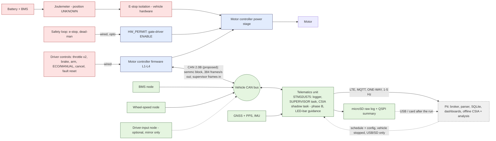

# Combined vehicle-electronics architecture (v0.3 PROPOSAL)

**Status: a proposal that combines two proposals.**
* This project's motor controller (semmc v0.3): host-tested firmware core and a draft schematic.
* The other engineer's telematics architecture: `telematics_overview` and `telematics_data_flow`, v0.1, 14/10/2026, two one-page diagrams.

Neither is built. Neither is confirmed for our vehicle. Nothing here is vehicle-validated.

## 1. Inputs and how they are treated
| Input | What it contributes | Treated as |
|---|---|---|
| Telematics overview v0.1 | STM32U575 (Cortex-M33) unit with: QSPI flash 8 MB; microSD (optional); RTC and watchdog; GNSS (u-blox NEO-M9N or similar) with UART + PPS; 6-axis IMU; CAN 2.0B transceiver (CANH, CANL, GND); SIMCom A7672 LTE Cat-1; USB-C; SWD + UART; analog, pulse and digital inputs; an LED-bar "burn / coast" display (optional); fused 5 V sensor supplies | **Proposed design input** |
| Telematics data flow v0.1 | Vehicle CAN bus with 120 Ω at both ends; nodes: motor controller ("rpm, current, temps"), BMS ("cell V, SOC, temps"), wheel-speed node (halls), driver-input node (dashed, i.e. optional). The unit collects, timestamps, logs and sends: LTE → MQTT live, downsampled to 1–5 Hz; flash logging every run; microSD raw (optional); USB download. Pit side: Mosquitto broker (`sem/car/telemetry`), Python/paho parser, SQLite, Grafana/Jupyter/MATLAB | **Proposed design input** |
| semmc v0.3 | Controller core (four-layer contract, wired driver authority, supervisor protocol with freshness and session), CAN protocol v1, draft schematic | **Proposed design** (host-tested only) |
| Cornell repositories | CHUDS CAN FD bus, Linux VCU | **Reference project only.** Not used as a fact about our vehicle (`PROVENANCE_AUDIT.md`) |

## 2. Combined block diagram

## 3. Where each function executes
| Function | Executes on | Timing class | Depends on | If it fails |
|---|---|---|---|---|
| L0 hardware shutdown: gate-driver faults, over-current comparator, external watchdog, safety loop (HW_PERMIT) | motor-controller **hardware** | immediate, no firmware | board hardware only | gates off |
| Current control, PWM, protection, state machine, L1–L4 arbitration | motor-controller MCU (STM32G474) | PWM-rate and 1 kHz | local sensors | protection and watchdog → torque 0 |
| **Driver authorization**: arm, ECO/MANUAL selection (edge), cancel, fault reset (edge, throttle released, condition gone), brake, dead-man | **wired to the motor controller** (ADR-0010) | 1 kHz | wires | inputs fail safe: open = not armed / braking / dead-man released |
| MANUAL torque request: throttle, two tracks | **wired to the motor controller** | 1 kHz | wires | implausible track → torque 0 |
| **Supervisor** (ECO torque request + operating envelope, pace correction against the offline schedule) | **telematics unit STM32U575 (proposed)**, as a dedicated high-priority task | 50 Hz requests, 10 Hz limits | CAN, wheel speed / GNSS, a schedule loaded before the run | controller leaves ECO with zero torque within `supervision.timeout_s` (100 ms synthetic, provisional); MANUAL stays available |
| Driver guidance: burn / coast / brake cues on the LED bar | telematics unit | ~10 Hz | the same schedule | advisory only: the driver keeps authority |
| CSIA, phase A (now) | **pit computer, offline, from logs** (Python adapter as frozen) | none | logs | no effect on the vehicle |
| CSIA, phase B (after the next detector freeze and a new held-out evaluation, `csia/EVALUATION_RESULTS.md` §6) | telematics unit, shadow task (C, float32 port needed) | 10 Hz advisory | CAN + direct sensors | advisory frames are recorded by the controller and **never** used for control (ADR-0008) |
| Logging | telematics unit: microSD for raw frames, QSPI flash for a decimated summary | continuous | storage | control unaffected |
| Live telemetry | telematics unit → LTE → MQTT broker | 1–5 Hz, best effort | cellular coverage | control unaffected |
| Schedule and configuration updates | pit → telematics unit by USB or SD card, **vehicle stopped** | between runs | a person | n/a |
| Energy accounting | official joulemeter (vehicle); controller INA228 (controller input); BMS | 10 Hz | n/a | n/a |

**CSIA does not execute in the motor controller** beyond recording advisory frames, and **never in the cloud**. The supervisor does not execute in the pit or the cloud.

## 4. The two paths missing from the telematics proposal
The proposal shows the motor controller only as a telemetry source ("rpm, current, temps"). A controller that accepts supervisory torque requests needs two more paths.

**4.1 Driver authorization path (wired, never CAN).**
* Safety loop: e-stop and dead-man go through the opto into HW_PERMIT, which gates the gate driver's ENABLE in hardware.
* Arm switch: DISARMED → READY.
* Brake: L1 inhibit, immediate zero.
* ECO/MANUAL switch: the ECO edge enters ECO only with an established supervisor session.
* Cancel: back to READY. Fault reset: a rising edge with the throttle released, accepted only once the fault condition is gone; it returns to DISARMED.

The proposal's optional driver-input node may **mirror** these on CAN for logging. The controller ignores CAN copies for authorization. Moving driver inputs onto CAN would need a hazard analysis, end-to-end protection and timeouts. It is not in v1.

**4.2 Torque-request path.**
* **MANUAL:** throttle (wired, 2 tracks) → arbiter (L1 inhibits, L2 hard ceilings, L4 comfort slew) → current loop.
* **ECO:** the telematics supervisor sends on CAN:
  * `sup_hello` at 2 Hz;
  * `sup_limits` at 10 Hz (envelope);
  * `sup_torque_req` at 50 Hz, with the session tag, sequence, source time and limits reference.

  The controller then checks CRC, sequence, freshness, session and limits reference, bounds the request by the L3 envelope (bounded ramp) and the L2 hard ceilings (immediate clamp), and passes it to the current loop. Silence, staleness, a cached sample or a broken session gives ECO → READY with zero torque.
* **Telemetry (one-way):** controller → CAN (11 messages, 384 frames/s at the protocol's periods) → telematics unit collects, timestamps and logs → LTE at 1–5 Hz → pit.

## 5. Real-time dependency chain
| Layer | May depend on | Must not depend on |
|---|---|---|
| L0 hardware shutdown | board hardware | firmware, CAN, telematics, LTE |
| L1/L2 inhibits and hard ceilings, MANUAL driving | controller firmware, local sensors, wired inputs | CAN, telematics, LTE, cloud |
| L3/L4 ECO operation | the above + CAN + the telematics supervisor task | LTE, MQTT, pit, cloud |
| Logging, live telemetry, pit analysis, offline CSIA | everything above | none (nothing depends on them) |

**The pit/cloud connection is outside the control dependency chain.** In v1 the telematics firmware has no path from LTE/MQTT to the CAN bus during a run. Losing LTE changes nothing in control. The CAN bus is a physically trusted domain (ADR-0005); a cellular link that could write to it would end that assumption.

The telematics unit becomes a **supervisory element** in ECO. Its failures are bounded by the controller's L2 ceilings, the L3 ramp bound and the supervision timeout, but its firmware then has to meet four requirements:
* the supervisor task cannot be starved by logging, SD writes or the modem: priority plus a task-level watchdog;
* the requests carry true source timestamps: a cached sample is detected (`test_eco_handshake_timeout_and_cached_sample`);
* the session restarts after any reboot;
* it never forwards cloud content to the bus.

## 6. Interface-difference table: telematics proposal v0.1 vs semmc v0.3
| Item | Telematics proposal v0.1 | semmc v0.3 | Difference / proposed resolution | Needed from the team |
|---|---|---|---|---|
| Bus type | CAN 2.0B | classic 11-bit 8-byte frames; FDCAN works in classic mode | compatible | confirm CAN 2.0B, no FD nodes |
| Bit rate / sample point | not stated | 250k, 500k or 1M computed feasible for every candidate crystal (`clock_tree_alternatives.md`) | open; no conflict | bit rate, sample point, transceivers |
| Identifier format and map | not stated | one 64-identifier block, base = `supervision.can_id_base` (default 0x300) | allocate a block; the protocol needs no change | 11 or 29-bit; the full ID map; a block for the controller |
| Physical layer | transceiver, CANH/CANL/GND, 120 Ω at both ends | TJA1051T/3, split-termination jumpers, CANH/CANL/GND connector (unselected) | compatible; terminations must sit at the two physical ends only | topology, connector, stub length, whether supply and ground run in the harness |
| Motor-controller data | "rpm, current, temps" | 11 messages: status, faults, command trace, driver controls, session, motion, currents, energy, thermal, validity, identity | a superset; the parser needs exact definitions | use `protocol/generated/semmc_base0x300.dbc` (or `tools/gen_dbc.py --base …`) |
| Message rates | logged "every run"; LTE 1–5 Hz downsampled | 384 frames/s from the controller (motion and currents at 100 Hz; status, trace and driver controls at 50 Hz) | the 8 MB flash cannot hold this for 40 min (§7) | logging profile; microSD fitted |
| Supervisor messages | absent | `sup_hello`, `sup_limits`, `sup_torque_req` (72 frames/s with the CSIA advisory) | add a supervisor task to the telematics firmware, or run without ECO (MANUAL only) | decision: which computer supervises |
| Driver inputs | optional driver-input node on CAN | wired to the controller (authority) | the node may mirror for logging only | which switches exist; whether a node is planned |
| Wheel speed | wheel-speed node (halls) on CAN; 3 pulse inputs on the unit | controller has motor halls only; vehicle speed from motor speed fails when the freewheel overruns | the supervisor uses wheel speed (CAN or direct pulse); the controller does not need it | pulses per revolution, wheel circumference, node message definition |
| Emergency stop | not on CAN | hardware safety loop; no CAN stop dependency | optional: a CAN stop message as an *additional* L1 inhibit, never the only stop | is any CAN stop message planned? |
| Time base | GNSS PPS + RTC | controller free-running µs timer; supervisor messages carry source time (ms) | the unit timestamps on receipt; align to GNSS time | receive-timestamp resolution |
| Power supply | wide-range DC input, buck 5 V and 3.3 V | controller logic from its own battery input through LM5164 | both draw auxiliary power (§7) | which battery feeds each board; joulemeter position |
| Downlink | MQTT broker; direction not stated | none needed | **one-way only** in v1; no cloud → CAN path | confirm |
| CSIA | not mentioned | offline now (pit); onboard shadow later | runs on the telematics unit or the pit computer, never in the controller's control path | n/a |
| Display | LED bar "burn / coast" (optional) | optimiser produces burn / coast / brake guidance | a natural fit for the guidance channel | LED count, location, readability |

## 7. Logging capacity and auxiliary power
Computed in `docs/generated/telematics_budget.md` (`tools/telematics_budget.py`). The rates of nodes that have no message definitions yet are assumed. Component currents are recalled typical values, not verified.

**Logging.** The controller's frames alone (384 + 72 frames/s × 16-byte records = 7.3 kB/s) fill the 8 MB QSPI flash in **17 minutes**. That is 43 % of a 40-minute attempt, before the BMS, wheel-speed, GNSS and IMU data are added. With them, the flash lasts 9–15 minutes.
* The microSD (optional in the proposal) should hold the raw log. It lasts 600–1,200 hours on 32 GB.
* The QSPI flash can hold a decimated summary. Even then, with the controller's 50–100 Hz messages cut to 10 Hz it holds 39.7 min at the low rate assumptions: still just short of a 40-minute attempt.
* LTE volume is small: 0.5–7.7 MB per 40-minute attempt.

**Auxiliary power.**

| Board | Estimated input power | Dominant term |
|---|---|---|
| Telematics unit | 0.45–2.1 W | LTE modem duty cycle |
| Motor-controller logic | 0.15–0.9 W | excludes gate-drive power and battery-voltage loads, both unknown |

* Over a 1000 s synthetic attempt, the telematics unit alone is 1–5 % of the synthetic track's 42.7 kJ, and the two boards together 1.4–7 %.
* Whether this counts depends on the joulemeter position and the 2027 rules (open).
* Batching LTE publishes reduces the modem's radio-on time.
* Measure both boards on the bench before deciding.

## 8. Requirements this places on the telematics unit (proposed, for the other engineer's review)
1. A CAN controller at the agreed bit rate, accepting the controller's block and sending the supervisor frames with the protocol's CRC and sequence. The generated C codec (`protocol/generated/semmc_protocol.{h,c}`, portable C11) and the DBC are the reference.
2. A supervisor task that runs at 50 Hz with bounded jitter and is protected from logging, SD and modem activity: priority, a watchdog, and no blocking I/O in the task.
3. Raw logging on microSD; a decimated summary on QSPI flash; receive timestamps disciplined by GNSS PPS.
4. No path from LTE/MQTT to the CAN bus in v1.
5. A measured power budget; batched LTE publishing.
6. Optional: driver guidance on the LED bar from the same schedule the supervisor follows.

Open questions are collected in `PHYSICAL_TEAM_QUESTIONNAIRE.md`.
