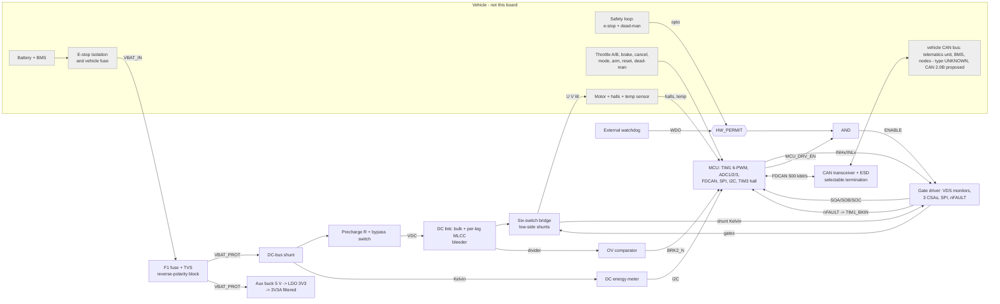

# Hardware functional architecture v0.2 (separate from component selection)

This document fixes **what each block must do and how the blocks connect**. It names no part numbers. Part choices, and whether each is frozen, live in [`hardware/selection/COMPONENT_SELECTION.md`](../hardware/selection/COMPONENT_SELECTION.md); a part can change without changing this architecture.

Status:
* **Functional architecture:** v0.2 draft, reviewable.
* **Component selection:** NOT frozen. Rating-dependent parts are UNRESOLVED until the motor and battery are measured.
* **Fabrication:** NOT READY. No layout, footprints or Gerbers exist, and none should be produced from this draft.

## 1. Power and signal block diagram

Power path: battery → (vehicle e-stop and fuse) → board fuse, TVS and reverse-polarity block → DC-bus shunt → precharge → DC link → bridge → motor. Logic rails are taken from the protected input **before** precharge, so the MCU runs while the link charges.

## 2. Functional blocks and their requirements

| Block | Function | Fixed requirement (this architecture) | Depends on (unresolved inputs) |
|---|---|---|---|
| Input protection | fuse, transient clamp, reverse polarity | fuse coordinated with the BMS and harness; clamp below the bridge's V_DS rating at surge; reverse-polarity strategy decided with the harness | V_bat,max, I_batt,max, BMS short-circuit current, connector |
| DC-bus measurement | battery-side V and I for energy | independent of the phase shunts; Kelvin shunt; ≥ 16-bit; on the controller's DC input | I_batt,max |
| Precharge | limit inrush into the DC link | bypass OFF at power-up and whenever the MCU is in reset; closed only after V_DC ≥ 0.95·V_BAT | C_link, V_bat,max |
| DC link | ripple current, low-inductance commutation loop | per-leg MLCC at the bridge plus bulk; bleeder | I_ph,rms, V_bat,max |
| Bridge | three-phase inverter | synchronous N-MOSFETs; low-side shunts with Kelvin taps; V_DS rating ≥ 1.5·V_bat,max (ringing margin, verified by measurement) | motor peak and continuous current, V_bat,max |
| Gate drive | gate drive, protection, current amplification | VDS over-current monitoring with hardware shutdown through nFAULT; ENABLE gated by HW_PERMIT; SPI-readable status; amplifiers ratiometric to the ADC reference | gate charge of the selected MOSFETs |
| Current sensing | three phase currents | **proposed** simultaneous sampling on three ADCs from one PWM trigger (not substantiated until configured and measured); window rule 39; two-phase reconstruction with flagging | I_ph,peak (shunt value, CSA gain) |
| Hardware shutdown | stop switching without firmware | TIM1 BKIN (nFAULT) and BKIN2 (OV comparator): MOE cleared, outputs idle low; ENABLE AND-gated by HW_PERMIT (safety loop and watchdog) | safety-loop voltage |
| Temperature | power stage and motor | NTC at the low-side MOSFETs; configurable motor-sensor bias; an unknown temperature derates | motor sensor type |
| Hall inputs | rotor position | RC filter, ESD, selectable supply | hall supply and output stage |
| Driver controls | wired driver authority (ADR-0010) | dual throttle tracks with open-wire detection; switches fail safe; dead-man and e-stop sensed separately from the hardware chain | pedal electrical range, harness |
| CAN | supervisory link | classic CAN 500 kbit/s, ID range 0x300–0x33F, ESD, termination selectable per bus position | harness, termination location |
| Aux rails | 5 V, 3.3 V, 3.3 V analog | ≥ 100 V-class input converter (margin over V_bat,max is the criterion); analog rail filtered | V_bat,max, V_bat,min |
| MCU and debug | control and logging | STM32G4-class Cortex-M4F; SWD and UART for the bench only; crystal clock (CAN) | n/a |

## 3. Interfaces fixed by this architecture
* **MCU pin functions:** `hardware/interfaces/pin_allocation_STM32G474VBCETx.csv`, generated from ST's pin database. The schematic reads the same file.
* **Shutdown paths and states:** `hardware/protection/SHUTDOWN_TRUTH_TABLE.md`.
* **Timing:** `hardware/timing/timing_budget.md`. Validator rule 39 enforces the sampling-window rule.
* **External connectors** (battery, motor phases, halls, motor temperature, driver controls, CAN): functions fixed, part numbers UNRESOLVED (`docs/archive/INTERFACE_CONTROL.md` §3).

## 4. Schematic draft
* **Files.** `hardware/kicad/semmc.kicad_sch` (root) and 12 hierarchical sheets, generated by `tools/gen_kicad_schematic.py`. A PDF for review is at `hardware/kicad/semmc_schematic_DRAFT.pdf`.
* **Connectivity check.** `--check` exports the netlist with kicad-cli 7.0.11 and compares KiCad's connectivity with the intended connectivity, net by net (`hardware/kicad/CONNECTIVITY_CHECK.md`).
  * This is not an ERC. KiCad 7 has no CLI ERC; since v0.4 the ERC runs in the CI `erc` job with KiCad 8.0.9 (0 errors, 9 warnings, `docs/VERIFICATION_REPORT.md` 5).
  * It is not a design review: `hardware/review/REVIEW_CHECKLIST.md` remains to be done by people.
