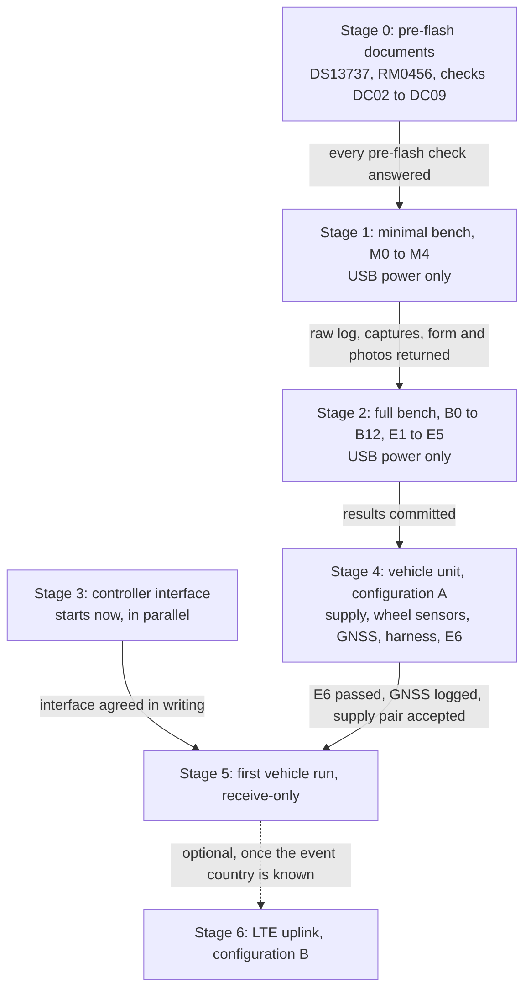

# Telemetry BOM and build plan

The telemetry unit costs **$97.68 to $117.74** as a full USB bench kit, **$462.73 to $666.45** installed on the vehicle (configuration A) and **$505.72 to $870.12** with the LTE uplink (configuration B). Nothing has run on a board yet: every result so far is host-tested, simulated or checked against ST documents. The next physical step is the minimal USB bench, $31.10 to $41.87 in parts, whose only technical gate is two ST documents (DS13737 and RM0456).

**Nothing has been ordered and no price is a quote.** Prices are search snapshots retrieved 2026-10-18 or stated allowances, in USD at quantity 1, from [`hardware/telematics/bom.yaml`](../hardware/telematics/bom.yaml); the generated page [`TELEMATICS_BOM.md`](TELEMATICS_BOM.md) keeps each line's source. Totals include 0 to 10 % sales tax because the purchasing state is not known. The unit only listens to the controller's bus: it has no propulsion authority, and CSIA runs in shadow (advisory) mode only.

This page is the build and purchasing view: what to buy at each stage, what opens the stage and what evidence closes it. The engineering plan is [`IMPLEMENTATION_PLAN.md`](IMPLEMENTATION_PLAN.md) (stages T0 to T5) and the open items are in [`BLOCKERS.md`](BLOCKERS.md). `tests/telematics/test_telematics_bom.py` checks every quantity, price and total below against the BOM source.

## 1. Where the project stands

Fifteen capabilities are shown in software or in documents; none has run on a board. HOST-TESTED means code run in CI on a PC, including the firmware's own C code built for the PC; SIMULATED means results on simulated drives; DOCUMENTS means checked against an ST document, not against the physical board. Labels and evidence: [`CLAIMS.md`](CLAIMS.md).

| Capability | How it is shown | Evidence | Still needs |
|---|---|---|---|
| Receive-only: the unit cannot transmit on the controller's bus or command propulsion | No transmit path in any production code (import-graph and code scan); CAN in bus-monitoring mode (C-RX-ONLY) | HOST-TESTED | E1 to E5 on the bench: transmitter off in hardware, no termination, one ground |
| Firmware builds for the NUCLEO-U575ZI-Q with the same hash every time | CI build of `ca74302` equals a local fresh-clone build byte for byte; three images: bench, CAN, vehicle (C-FIRMWARE-TARGET) | HOST-TESTED | Flash and start on a real board (M1) |
| Board pins, console routing, power and crystal | UM2861 Rev 10, check DC01 | DOCUMENTS | M0: sticker, jumpers and pin positions on the actual board |
| Silicon errata handled for every board revision | ES0499 Rev 12, check DC10; three firmware fixes | DOCUMENTS | Checks DC02 to DC09 from DS13737 and RM0456 |
| Wheel speed: no false 0 m/s; stuck or disconnected sensor flagged | C firmware and Python reference tested on a PC (C-HALL) | HOST-TESTED | M2, B3 and B6 with a signal generator |
| Pulse to plot: pulse, capture, log, power cycle, dump, decode, database, review, plot | A known pulse train reproduced exactly in the firmware's PC build; rehearsal passes (C-BENCH-CHAIN) | HOST-TESTED | M0 to M4 on the minimal bench |
| Local log: drops counted, restarts detected, logging continues with no network | Fault-injection tests (C-STORAGE, C-LOG-OUTAGE) | HOST-TESTED | B8 and B9: power cut during a write, flash full |
| Log length: the 16 MiB NOR holds 138 min at bench rates, 26.7 min at full rate | Computed with the firmware's own code ([`generated/telematics_storage.md`](generated/telematics_storage.md)) | HOST-TESTED | The real controller's frame rate and the attempt length |
| Evidence platform: schema, evidence states, timing, lineage, cross-checks, receipts, pit queries | Unit and integration tests (C-SCHEMA to C-PIT-QUERIES) | HOST-TESTED | Real recordings |
| Live uplink over MQTT with outage and reconnect | Demonstration through a real Mosquitto broker, 9 of 9 checks; the message, its 30-message backlog and its accounting are firmware now, and every value the firmware sends equals the pit's import of its log (C-LIVE-FIRMWARE) | HOST-TESTED | The modem's transport on the board (T-MODEM) |
| GNSS and PPS: the whole log on UTC | The firmware's GNSS code in the vehicle image, unit-tested; on a simulated drive through the firmware the UTC error is 0 and no PPS edge is left unlabelled (C-GNSS-FIRMWARE, C-FIRMWARE-LOOP) | HOST-TESTED | DC19 to DC21 from the u-blox and SparkFun documents; bench step B13 |
| Firmware in the loop: the simulated vehicle drives the firmware's own code into the pit | Every record and live sequence number accounted for, a GNSS outage attributed to GNSS, a 5 % wheel-sensor error localized to that wheel (C-FIRMWARE-LOOP) | SIMULATED | Bench and vehicle data |
| Fault localization protocols EXP-01 to EXP-04 | Simulated drives (C-EXP01-SIM to C-EXP04-SIM) | SIMULATED | EXP-01 bench stage, then vehicle data |
| CSIA in shadow mode: only valid evidence in, advisory output only | Boundary tests (C-CSIA-BOUNDARY); the 328 of 550 clean-run case is an unsupported adapter-input configuration, not evidence that the algorithm is inferior (C-CSIA-CLEAN-RUN); with supported inputs the same run disagrees on 2 of 550 ticks, both at simulated torque steps (C-CSIA-SUPPORTED) | HOST-TESTED, SIMULATED | The controller's torque constant, an independent battery-side reference and real data |
| Bench parts match the firmware: every bench part has a driver | `tools/telematics_bom.py` checks the BOM against the driver sources | HOST-TESTED | Live quotes |

## 2. Vehicle battery

The battery is **48 V nominal, 10 Ah, as the vehicle team reports it** ([`BATTERY.md`](BATTERY.md)), about 480 Wh nominal. These values are not yet confirmed by a data sheet.

They do not fix the unit's supply parts. The TVS, DC-DC, fuse and reverse diode are rated from the maximum charged voltage, and a 48 V nominal pack can charge well above 48 V depending on chemistry and cell count. Rule 57a also limits the vehicle to 60 V on board, maximum charged voltage plus transients ([`RULES_COMPLIANCE.md`](RULES_COMPLIANCE.md)). Until the maximum is known, the supply lines in section 4 stay placeholders and the unit is not powered from the vehicle ([T-VEH-PWR](BLOCKERS.md#t-veh-pwr)).

Still needed from the vehicle team ([`INPUT_SHEET.md`](INPUT_SHEET.md) item 2, [B-BAT-V](BLOCKERS.md#b-bat-v)): the battery and BMS model numbers, photos of their labels, and their data sheets with the maximum charged and minimum operating voltage.

## 3. BOM: bench kit (USB-powered)

The bench kit is 14 lines, $97.68 to $107.04 before tax; the minimal bench uses only the first three ($31.10 to $38.06). Every part with electronics is one the firmware already drives, and the NOR and sensors are identified at start-up by their ID registers. The board runs from its USB port, so no supply part is needed.

| ID | Item | Part | Qty | Unit (USD) | Line (USD) | Needed for |
|---|---|---|---|---|---|---|
| `mcu` | Development board, STM32U575 with on-board ST-LINK | ST NUCLEO-U575ZI-Q | 1 | 24.15 to 26.11 | 24.15 to 26.11 | Minimal bench |
| `usb_cable` | USB data cable to the ST-LINK port CN1 (Micro-B; the board's Type-C port is not used) | Type-A or Type-C to Micro-B, data capable | 1 | 3.00 to 8.00 | 3.00 to 8.00 | Minimal bench |
| `jumpers` | Male/male jumper wires, 40 x 150 mm | Adafruit 758 | 1 | 3.95 | 3.95 | Minimal bench |
| `nor_chip` | SPI NOR flash 128 Mbit, SOIC-8 (log storage) | Winbond W25Q128JVSIQ | 1 | 1.88 | 1.88 | Full bench: NOR log |
| `nor_adapter` | SOIC-8 to 0.1 in breakout PCB, 6 pack | Adafruit 1212 | 1 | 2.95 | 2.95 | Full bench: NOR log |
| `nor_passives` | 100 nF capacitor, 10 kOhm /CS pull-up, 120 Ohm bench CAN end | any through-hole | 1 | 0.30 to 1.50 | 0.30 to 1.50 | Full bench: NOR and CAN |
| `headers` | 0.1 in male header strips, 10 pack | Adafruit 392 | 1 | 4.95 | 4.95 | Full bench |
| `imu` | 6-axis IMU breakout, I2C, Qwiic | SparkFun SEN-19764 (ISM330DHCX) | 1 | 25.50 | 25.50 | Full bench: B12 |
| `qwiic_jumper` | Qwiic to breadboard jumper cable | SparkFun PRT-17912 | 1 | 1.95 | 1.95 | Full bench: B12 |
| `qwiic_cable` | Qwiic / STEMMA QT cable, 100 mm | Adafruit 4210 | 1 | 0.95 | 0.95 | Full bench: B12 |
| `tmp117` | Temperature sensor breakout TMP117, I2C | Adafruit 4821 | 1 | 15.25 | 15.25 | Full bench: B12 |
| `can_xcvr` | CAN transceiver breakout with silent pin and switchable termination | Adafruit 5708 CAN Pal (TJA1051T/3) | 1 | 3.95 to 5.15 | 3.95 to 5.15 | Full bench: B11, E1 to E3 |
| `breadboard` | Half-size breadboard | Adafruit 64 | 1 | 4.95 | 4.95 | Full bench |
| `jumpers_fm` | Female/male jumper wires, 40 x 150 mm | Adafruit 826 | 1 | 3.95 | 3.95 | Full bench: B11 |
| **Total** | **Bench parts, before tax** | | | | **97.68 to 107.04** | |

## 4. BOM: vehicle unit, configuration A

Configuration A adds $365.05 to $502.10 to the bench kit before tax: sensors, GNSS, harness, enclosure, spares, shipping and the vehicle supply. The bench parts move into the unit, so nothing is bought twice. The supply lines are placeholders until the pack's maximum voltage is known (section 2).

| ID | Group | Item | Part | Qty | Unit (USD) | Line (USD) |
|---|---|---|---|---|---|---|
| `can_cable` | Vehicle bus | Shielded 120 ohm CAN twisted pair for the tap, per foot (10 ft placeholder) | Belden 9841 | 10 | 5.49 | 54.90 |
| `wheel_hall` | Sensors | Wheel Hall switch on a potted carrier, per wheel (not selected: needs the wheel geometry) | DRV5023 class | 3 | 1.00 to 5.00 | 3.00 to 15.00 |
| `magnets` | Sensors | Wheel magnets, N52 disc 1/4 x 1/8 in, 4 per wheel (placeholder count) | K&J D42-N52 | 12 | 0.43 to 0.52 | 5.16 to 6.24 |
| `gnss` | Sensors | GNSS receiver with PPS output, SMA | SparkFun GPS-17285 (u-blox NEO-M9N) | 1 | 76.50 | 76.50 |
| `gnss_antenna` | Sensors | Active GNSS antenna, SMA, with cable | Adafruit 960 | 1 | 21.50 to 27.75 | 21.50 to 27.75 |
| `tmp117_more` | Sensors | Two more TMP117 breakouts: battery surface and motor case | Adafruit 4821 | 2 | 15.25 | 30.50 |
| `nor_vehicle_note` | Storage | The bench W25Q128JV moves into the unit | no extra part | 1 | 0.00 | 0.00 |
| `dcdc` | Supply (blocked) | Isolated DC-DC to 5 V, input range covering the pack maximum | not selected | 1 | 13.95 to 60.00 | 13.95 to 60.00 |
| `fuse_holder` | Supply (blocked) | In-line fuse holder rated above the pack maximum | candidate Littelfuse 0FHM0003ZXJP (58 V) | 1 | 6.92 | 6.92 |
| `fuse` | Supply (blocked) | DC fuse rated above the pack maximum | candidate Littelfuse 0997002.WXN (58 V, 2 A) | 1 | 0.42 | 0.42 |
| `tvs` | Supply (blocked) | Input TVS diode | not selected | 1 | 0.42 to 2.00 | 0.42 to 2.00 |
| `rev_diode` | Supply (blocked) | Reverse-polarity Schottky, 100 V 3 A | onsemi MBRS3100T3G | 1 | 1.00 to 2.00 | 1.00 to 2.00 |
| `supply_passives` | Supply (blocked) | DC-DC capacitors and perfboard carrier | per the chosen module | 1 | 3.00 to 10.00 | 3.00 to 10.00 |
| `conn_receptacle` | Harness and enclosure | Sealed DT 4-way receptacle (CAN tap, wheels, temperatures, power) | TE/Deutsch DT04-4P | 4 | 5.36 to 6.09 | 21.44 to 24.36 |
| `conn_plug` | Harness and enclosure | Sealed DT 4-way plug | TE/Deutsch DT06-4S | 4 | 2.13 to 2.82 | 8.52 to 11.28 |
| `wedge_p` | Harness and enclosure | Wedgelock for DT04-4P | W4P | 4 | 0.19 | 0.76 |
| `wedge_s` | Harness and enclosure | Wedgelock for DT06-4S (no price found: not in the totals) | W4S | 4 | unknown | unknown |
| `contacts_pin` | Harness and enclosure | DT size-16 pin contacts | TE 0460-202-16141 | 16 | 0.25 | 4.00 |
| `contacts_socket` | Harness and enclosure | DT size-16 socket contacts | TE 0462-201-16141 | 16 | 0.37 to 0.67 | 5.92 to 10.72 |
| `wire` | Harness and enclosure | Hook-up wire, heat-shrink, sleeving, cable ties | assorted | 1 | 15.00 to 35.00 | 15.00 to 35.00 |
| `enclosure` | Harness and enclosure | Enclosure with clear lid, 180 x 180 x 90 mm | Hammond 1554WA2GYCL | 1 | 42.00 | 42.00 |
| `spare_can` | Spares | CAN transceiver breakout | Adafruit 5708 | 1 | 3.95 to 5.15 | 3.95 to 5.15 |
| `spare_fuses` | Spares | Fuses | Littelfuse 0997002.WXN | 2 | 0.42 | 0.84 |
| `spare_tvs_diode` | Spares | TVS and Schottky, once selected | as `tvs` and `rev_diode` | 1 | 1.42 to 4.00 | 1.42 to 4.00 |
| `spare_probe` | Spares | TMP117 breakout | Adafruit 4821 | 1 | 15.25 | 15.25 |
| `spare_nor` | Spares | NOR chip | Winbond W25Q128JVSIQ | 1 | 1.88 | 1.88 |
| `spare_hall` | Spares | Hall switch and 2 magnets | as `wheel_hall` and `magnets` | 1 | 1.86 to 6.04 | 1.86 to 6.04 |
| `spare_contacts` | Spares | 4 contacts of each kind and one housing of each | as the connector lines | 1 | 9.97 to 12.59 | 9.97 to 12.59 |
| `shipping` | Shipping | Three small orders (Digi-Key, Adafruit, SparkFun) |  | 3 | 4.99 to 12.00 | 14.97 to 36.00 |
| **Total** | | **Configuration A additions, before tax** | | | | **365.05 to 502.10** |

## 5. BOM: LTE uplink, configuration B, and options

Configuration B adds the LTE uplink, $42.99 to $185.15 before tax. The modem depends on the LTE bands of the event country. The driver display is optional and gives advice only, with no speed control.

| ID | Config | Item | Part | Qty | Unit (USD) | Line (USD) |
|---|---|---|---|---|---|---|
| `modem` | B | LTE Cat-1 modem board with UART | Waveshare A7670E HAT (Europe/Asia) or SparkFun LTE Stick LARA-R6 (North America) | 1 | 28.99 to 149.95 | 28.99 to 149.95 |
| `lte_antenna` | B | LTE antenna 700 to 2700 MHz, SMA | Teltonika PR1CS450 or Pulse WA700/2700SMA | 1 | 11.00 to 27.20 | 11.00 to 27.20 |
| `rf_pigtail` | B | u.FL to SMA pigtail, if the modem board has u.FL | generic | 1 | 3.00 to 8.00 | 3.00 to 8.00 |
| `display` | B, optional | Driver display, sunlight-readable memory LCD, advice only | Adafruit 4694 Sharp Memory 2.7 in | 1 | 44.95 | 44.95 |

Options are in no total, because the firmware has no driver for them yet:

| ID | Item | Part | Qty | Unit (USD) | Line (USD) | Why not counted |
|---|---|---|---|---|---|---|
| `storage_socket` | microSD socket breakout (larger vehicle log) | Adafruit 254 | 1 | 7.50 | 7.50 | the microSD driver is not written |
| `storage_card` | microSD card, consumer to industrial | Kingston SDCIT2/8GB at the high end | 1 | 5.00 to 55.73 | 5.00 to 55.73 | with `storage_socket` |
| `temp_probes` | Waterproof 1-Wire temperature probes | DS18B20 stainless probe | 3 | 2.19 to 5.50 | 6.57 to 16.50 | the 1-Wire driver is not written |

## 6. Equipment

Equipment is never in a configuration total. The bench assumes the lab lends a signal generator, an oscilloscope and a multimeter; buying the rest costs $85 to $180.

| ID | Equipment | Needed for | Qty | Unit (USD) | Line (USD) | Note |
|---|---|---|---|---|---|---|
| `signal_gen` | Signal generator: 0 to 3.3 V square wave, 1 Hz to 5 kHz, with a stated frequency accuracy | Minimal and full bench | 1 | 0.00 | 0.00 | assumed borrowed |
| `scope` | Oscilloscope or logic analyzer, 2 channels, 10 MS/s or more | Minimal and full bench, E1 | 1 | 0.00 | 0.00 | assumed borrowed |
| `multimeter` | Multimeter | Minimal and full bench | 1 | 0.00 | 0.00 | assumed owned or borrowed |
| `soldering` | Soldering iron, solder, flux | Full bench: NOR onto its adapter | 1 | 0.00 | 0.00 | assumed owned or borrowed |
| `usb_can` | USB-CAN adapter, CANable class | Full bench: B11 | 2 | 30.00 to 60.00 | 60.00 to 120.00 | two needed |
| `crimper` | Crimp tool for DT contacts | Vehicle harness | 1 | 25.00 to 60.00 | 25.00 to 60.00 | genuine TE HDT-48-00 is $427.05: borrow one |

## 7. Budget by stage

The vehicle unit fits $1,000 in every configuration, and $500 only at the low end of configuration A. Each stage includes the one before it.

| Stage | Includes | Total with 0 to 10 % tax (USD) | Within $500? | Within $1,000? |
|---|---|---|---|---|
| Minimal bench | `mcu`, `usb_cable`, `jumpers` | 31.10 to 41.87 | yes | yes |
| Full bench | the whole bench kit | 97.68 to 117.74 | yes | yes |
| Configuration A | bench kit + vehicle unit with local logging | 462.73 to 666.45 | low end only | yes |
| Configuration B | A + LTE uplink | 505.72 to 870.12 | no | yes |
| B with display | B + driver display | 550.67 to 919.56 | no | yes |

* **Equipment, only if not owned:** $85 to $180 (section 6).
* **Recurring, configuration B only:** a $3 SIM, then $1.94 to $66.84 a month, for 2 to 20 running hours a month at 15.6 MB per running hour (2 Hz live messages). Replace the hours with the team's test plan.
* **Unpriced:** four DT06-4S wedgelocks (`wedge_s`).
* **Largest swings:** the event country sets the modem ($28.99 or $149.95); the pack maximum voltage sets the supply lines ($25.71 to $81.34 today); the controller interface and the wheel geometry set the CAN cable, connectors, Hall switch and magnets.

Before anything is ordered, every line needs a dated live quote and the team lead's agreement ([T-PARTS](BLOCKERS.md#t-parts)).

## 8. Plan by stage

Seven stages, each opened by a gate and closed by evidence committed to the repository. Stages 1 and 2 run on USB power with nothing connected to the vehicle. Stage 3 can start today: it needs answers from the controller team, not hardware.

| Stage | Who | Buys | Implementation plan |
|---|---|---|---|
| 0. Pre-flash documents | team lead, software side | nothing | T2 |
| 1. Minimal bench | physical team | `mcu`, `usb_cable`, `jumpers` | T2 |
| 2. Full bench | physical team | the rest of the bench kit, two `usb_can` | T2, T3 |
| 3. Controller interface | controller team, software side | nothing | T1 |
| 4. Vehicle unit | vehicle team, software side, physical team, team lead | configuration A | T1, T2 |
| 5. First vehicle run | vehicle team, physical team | nothing | T5 |
| 6. LTE uplink (optional) | team lead, software side | configuration B | T4 |

### Stage 0: pre-flash documents (now)

- [ ] Commit DS13737 and RM0456 to `docs/reference/datasheets/` as `st-ds13737-stm32u575.pdf` and `st-rm0456-stm32u5.pdf` ([T-U5-DOCS](BLOCKERS.md#t-u5-docs))
- [ ] Software answers checks DC02 to DC09 with revision and page ([`DOCUMENT_CHECKS_RECORD.md`](../telematics/bench/DOCUMENT_CHECKS_RECORD.md)); a discrepancy is fixed, which makes a new bench candidate with new hashes
- [ ] Borrow a signal generator with a stated frequency accuracy, an oscilloscope and a multimeter
- [ ] Team lead approves the three minimal-bench parts

Done when every pre-flash check is answered and none contradicts the firmware.

### Stage 1: minimal bench, M0 to M4 (USB power only)

The procedure, expected results and stop conditions are in [`HANDOFF_MINIMAL.md`](../telematics/bench/HANDOFF_MINIMAL.md).

- [ ] M0, unpowered: check the image hash, read the board sticker and jumpers, set the generator to 100.000 Hz from 0 to 3.3 V on the scope, wire A0 (CN9 pin 1) and GND
- [ ] M1: flash `tm_u575.bin` from CI artifact 12160820013 over SWD at 8 MHz and capture the banner; never press the blue button B1
- [ ] M2: generator on for 60 s; expect about 100 edges per status line, a speed shown and `lost=0`
- [ ] M3: unplug USB for at least 10 s, plug back in, type `DUMP`
- [ ] M4: run the bench chain; expect a median speed within 0.2 % of 10.00 m/s and about 600 m
- [ ] Return the raw captures, the filled results form, setup photos, instrument settings and the manifest

Done when the files are committed under `telematics/bench/results/<date>_minimal/`: the first evidence from a real board.

### Stage 2: full bench, B0 to B12 and E1 to E5 (USB power only)

About 4 hours, of which B7 alone takes 75 min ([`BENCH.md`](../telematics/firmware/BENCH.md)). Starts when Stage 1 has passed.

- [ ] Commit the W25Q128JV data sheet; software answers checks DC11 to DC15 before the NOR is fitted
- [ ] Buy the other 11 bench-kit lines and two USB-CAN adapters
- [ ] Solder the W25Q onto its adapter and build the breadboard
- [ ] B0 to B10: restarts, wheel input at 100 Hz, log import, rates, stuck and disconnected sensor, 75 min across the timer overflow, power cut during a write, flash full, erase
- [ ] B11 and E1 to E5: CAN receive with our transmitter off in hardware, unpowered behaviour, termination, bus loading, ground
- [ ] B12: IMU and TMP117
- [ ] EXP-01 bench stage: two generator channels at a known ratio

Done when the results form for B0 to B12 and E1 to E5 is committed under `docs/reference/bench/` ([T-BENCH1](BLOCKERS.md#t-bench1)).

### Stage 3: controller interface (start now, in parallel)

- [ ] Send [`CONTROLLER_INTERFACE_REQUEST.md`](CONTROLLER_INTERFACE_REQUEST.md) to the controller team
- [ ] Receive bus type, bit rate, identifiers, connector, ground point, message definitions (DBC) and a recording
- [ ] Software commits a mapping for their DBC and decodes their recording with every essential signal valid
- [ ] The controller team confirms the decoded values
- [ ] Agree the tap point, stub length and termination (E3, E4)

Done when the interface is agreed in writing ([T-CTRL-IF](BLOCKERS.md#t-ctrl-if)). Nobody connects to the controller's bus before this and E1 to E5.

### Stage 4: vehicle unit, configuration A (built and checked on the bench)

Starts when Stage 2 has passed.

- [ ] Vehicle team gives the pack's maximum and minimum voltage (section 2); select a TVS and DC-DC pair that passes the rule in `tools/telematics_bom.py`
- [ ] Vehicle team gives the wheel geometry; select the Hall switch, magnet count and mounting
- [ ] Decide log storage from the attempt length and the controller's frame rate ([T-STORAGE](BLOCKERS.md#t-storage))
- [x] Software adds GNSS and PPS to the firmware: image `tm_u575_vehicle`, host-tested, never run on a board ([T-GNSS](BLOCKERS.md#t-gnss))
- [ ] Commit the u-blox M9 interface description and the GPS-17285 schematic; software answers DC19 to DC21 ([`DOCUMENT_CHECKS_RECORD.md`](../telematics/bench/DOCUMENT_CHECKS_RECORD.md))
- [ ] Wire the GNSS board (its TX to PD6 at CN9 pin 4, its RX to PD5 at CN9 pin 6, PPS to PA1 at CN10 pin 11, 3V3 and GND), flash `tm_u575_vehicle` and run bench step B13: GNSS records at 10 Hz, one labelled PPS record per second
- [ ] Live quotes for every configuration A line; the team lead approves the order
- [ ] Build the harness with DT connectors and the enclosure; pass E6 (unit supply) on the bench

Done when E6 has passed, GNSS and PPS are logged on the bench, and the supply pair is accepted.

### Stage 5: first vehicle run, receive-only

Starts when Stages 3 and 4 are done, E1 to E6 have passed and the controller team agrees.

- [ ] Install the unit with one ground at the agreed point and no USB-connected PC on the vehicle
- [ ] Log a run, import it at the pit and review it in shadow mode
- [ ] Run the EXP-01 vehicle stage, then EXP-02 to EXP-04 as their inputs allow

Done when a vehicle log with its receipts is committed. Only then may a claim say VEHICLE-TESTED, and only for what that log shows.

### Stage 6: LTE uplink, configuration B (optional)

Starts when the event and its country are known ([B-RULES](BLOCKERS.md#b-rules)).

- [ ] Pick the modem board for the event country's LTE bands
- [x] Software writes the live message, its backlog and its accounting in the firmware (`tm_live`, host-tested)
- [ ] Software writes the modem's MQTT transport behind the firmware's link interface, from the modem's AT command manual ([T-MODEM](BLOCKERS.md#t-modem))
- [ ] On the bench, live messages reach a pit broker, with outages and restarts accounted for
- [ ] Decide on the optional driver display

Done when live messages from the board reach the pit on the bench.

## 9. Team inputs

Eleven inputs from people gate the plan; the first three block the next physical step.

| Input | From | Unblocks | Register |
|---|---|---|---|
| STM32U575 data sheet DS13737 and reference manual RM0456 | team lead (st.com) | Stage 1: flashing the board | [T-U5-DOCS](BLOCKERS.md#t-u5-docs) |
| Signal generator with a stated frequency accuracy, oscilloscope, multimeter | lab | Stage 1 | [T-BENCH1](BLOCKERS.md#t-bench1) |
| Approval to buy the minimal-bench parts, then the rest of the bench kit | team lead | Stages 1 and 2 | [T-PARTS](BLOCKERS.md#t-parts) |
| W25Q128JV data sheet | team lead (winbond.com) | Stage 2: NOR log | [T-U5-DOCS](BLOCKERS.md#t-u5-docs) |
| Interface answers, DBC and a recording | controller team | Stage 3; any connection to their bus | [T-CTRL-IF](BLOCKERS.md#t-ctrl-if) |
| Pack maximum and minimum voltage: battery and BMS data sheets, label photos | vehicle team | Stage 4: vehicle supply parts | [B-BAT-V](BLOCKERS.md#b-bat-v) |
| Wheel geometry: diameter, mounting points, room for magnets | vehicle team | Stage 4: wheel sensors | [B-DRIVETRAIN](BLOCKERS.md#b-drivetrain) |
| Attempt length and the controller's frame rate | team lead, controller team | Stage 4: log storage | [T-STORAGE](BLOCKERS.md#t-storage) |
| Live quotes for every line | team lead | any order | [T-PARTS](BLOCKERS.md#t-parts) |
| Event name, country and official rule PDF | team lead | Stage 6: modem bands; rule checks | [B-RULES](BLOCKERS.md#b-rules) |
| Planned running hours per month | team lead | recurring cost | none: an assumption in `hardware/telematics/bom.yaml` |

## 10. Sources

* [`hardware/telematics/bom.yaml`](../hardware/telematics/bom.yaml): every line with its dated price source; [`TELEMATICS_BOM.md`](TELEMATICS_BOM.md) and [`generated/telematics_bom.json`](generated/telematics_bom.json): the generated totals
* [`CLAIMS.md`](CLAIMS.md): each claim's label and evidence; [`BLOCKERS.md`](BLOCKERS.md): the open items
* [`HANDOFF_MINIMAL.md`](../telematics/bench/HANDOFF_MINIMAL.md) and [`DOCUMENT_CHECKS_RECORD.md`](../telematics/bench/DOCUMENT_CHECKS_RECORD.md): the minimal bench and its document gate
* [`BENCH.md`](../telematics/firmware/BENCH.md): the full bench, B0 to B13 and E1 to E6
* [`BATTERY.md`](BATTERY.md): the team-reported battery values and what they do not establish
* [`VERIFICATION_REPORT.md`](VERIFICATION_REPORT.md): what was run, on which commit
