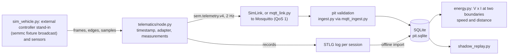

# host: Python software that runs on a computer

`host/` holds the Python side of the project: the code that runs on a laptop, a pit computer or a continuous-integration runner, not on the vehicle's microcontrollers. Nothing in it has run on vehicle hardware.

**Scope (v0.7).** `telematics/` and `pit/` are the telematics delivery: the receive-only node model, the measurement model, the controller adapters and the pit tools; they are exercised with a Python stand-in for the external controller (`host/telematics/sim_vehicle.py`) and never need our controller build. `telemetry_adapter/` (the ECO supervisor, the co-simulation with our controller core and the legacy supervised node), `logger/` and `replay/` are deferred controller development, used only by the legacy simulations (suite `controller`, [`../docs/scope.yaml`](../docs/scope.yaml)). `csia_adapter/` is the frozen evaluation (reference).

## 1. What this directory contains

| Subdirectory | Contents |
|---|---|
| [`telematics/`](telematics/) | The host model of the receive-only telematics unit (the NUCLEO-U575ZI-Q firmware in [`../telematics/firmware/`](../telematics/firmware/README.md) follows it; CAN: Controller Area Network). It timestamps every received frame, decodes it with a controller adapter into measurements (`measurement.py`, `signals.py`, `controller_adapter.py`), turns wheel edges into speed and distance (`wheel.py`), writes the local log in the STLG format (the unit's block log; "STLG" is the 4-byte marker at the start of every file) and sends a 2 Hz summary over the uplink. The same package has the clock models (GNSS receiver PPS edges, where GNSS is satellite navigation and PPS is the pulse-per-second edge that marks each UTC second, UTC being Coordinated Universal Time), the synthetic wheel, GNSS and IMU sensors (IMU: inertial measurement unit), and the uplink client for MQTT (Message Queuing Telemetry Transport), the publish/subscribe protocol of the uplink, in which messages pass through a broker (Mosquitto here). |
| [`pit/`](pit/) | The pit side: the MQTT ingestion service, validation of every live message before storage, storage in one SQLite database (SQLite: an SQL database held in a single file), the offline import of STLG logs into that database, the pit-side shadow replay of two sensor-consistency monitors, and an energy-per-distance summary of a stored run. The two monitors are R3v, the calibrated-residual monitor with majority-vote attribution that the v2 evaluation selected, and CSIA2, the experimental version 2 adapter built on CSIA (see the `csia_adapter/` row). |
| [`telemetry_adapter/`](telemetry_adapter/) | Deferred controller development and LEGACY research simulation: the ECO supervisor, the lockstep co-simulation with our C controller core, an end-to-end scenario runner, and `legacy_node.py`, the earlier supervised telematics node used only by `tools/run_host_demo.py --legacy-supervised` and `tools/run_mqtt_demo.py --legacy-supervised`. Not on the telematics path. |
| [`csia_adapter/`](csia_adapter/) | CSIA adapters and their frozen evaluation harness. CSIA (Cross-Sensor Intelligence Architecture) is a pinned third-party trust core; here it is wrapped as an experimental sensor-consistency diagnostic, run in shadow mode only. The harness also defines R3v and CSIA2. |
| [`logger/`](logger/) | The semmc-log v1 text event format: scenario logs for the C host executable and decoding of the controller's transmitted frames. |
| [`replay/`](replay/) | Replay of a recorded semmc-log through the C core, with requested and accepted torque and the reasons for any difference. |
| [`vcu_bridge/`](vcu_bridge/) | An optional SocketCAN bridge (SocketCAN: the Linux kernel's socket interface to CAN adapters), written as a proposal for a Linux computer on the bus (VCU: vehicle control unit). |

"semmc" is the name of the controller's CAN protocol, defined in [`../protocol/protocol.yaml`](../protocol/protocol.yaml).

## 2. Who works here

* **Telemetry and integration members:** `telematics/`, `pit/ingest.py` and `pit/mqtt_ingest.py`, `telemetry_adapter/`, `logger/`, `replay/`, `vcu_bridge/`. They keep the node model, the log format, the uplink and the pit database consistent with [`../docs/ICD.md`](../docs/ICD.md) (sections 4 and 8 to 10).
* **Data-analysis members:** the pit database, `pit/shadow_replay.py` and `pit/csia_replay.py`, and the reports these produce. The files in `csia_adapter/` are frozen (section 7): they are read and run, not edited.

Changes to the controller itself belong in [`../firmware/`](../firmware/README.md); changes to CAN messages are made in `protocol/protocol.yaml` and regenerated, never in the generated codec.

## 3. Important files

Each table lists the maintained files of one subdirectory. "Inputs" and "Outputs" are what the module consumes and produces when it runs in the chain of section 4.

### 3.1 `telematics/`

| File | What it does in the system | Inputs | Outputs |
|---|---|---|---|
| [`telematics/node.py`](telematics/node.py) | Host model of the receive-only unit's tasks. Every CAN frame is timestamped in the telematics clock, queued as raw bytes (STLG `CAN2`) and decoded by the controller adapter into measurements; wheel edges go into per-channel accumulators drained into `WHEEL_EDGES` records every 50 ms (a heartbeat without edges); GNSS, IMU, temperature and battery-monitor samples become measurements and records. A bounded log queue (512) drops and counts when full; the writer moves records at a bounded rate. Every 0.5 s a `sem.telemetry.v4` summary: per signal `[value, q, age, seq, time reference]`, null when missing, stale or invalid. While the link is down messages wait in a 30-message queue (oldest dropped and counted). No method transmits a frame. `crash()` models a restart without shutdown. `SimLink` is the in-process link with outages. | frames (time, id, data, extended, FD), wheel edges and line levels, sensor samples, PPS edges; an adapter; `NodeConfig` | STLG records; JSON messages; counters |
| [`telematics/measurement.py`](telematics/measurement.py) | The measurement model: record id, source, signal, value, unit, receive and sample times, uncertainty, source sequence, validity, provenance, upper bound; `checked()` classifies sentinels, ranges and flags; `LatestTable` reports missing and stale as null | values from adapters and drivers | `Measurement` objects; live entries |
| [`telematics/signals.py`](telematics/signals.py) | The signal registry: identity, unit, role (energy essential, battery total, optional diagnostic, motion, environment), range and staleness limit; `REGISTRY_ID` is named in every live message | | lookup by signal id |
| [`telematics/controller_adapter.py`](telematics/controller_adapter.py) | Controller receive adapters: `SimFixtureAdapter` (semmc simulation fixture: CRC, protocol sequence, `ctrl_validity`, no invented sample time), `DbcAdapter` (a DBC and a unit-checked mapping file), `NullAdapter`; `from_meta` rebuilds the adapter a log names | frames | `AdapterResult` (decoded, ignored, unknown_id, invalid) with measurements |
| [`telematics/wheel.py`](telematics/wheel.py) | Edge accumulator (the firmware's `tm_wheel.c` follows it byte for byte) and the estimator: speed over complete edge intervals, distance from the cumulative count, `no_evidence` with an upper bound when no edge comes, 0 m/s only with the line held at the magnet level | edge times, line levels, wheel circumference and edges per revolution | `WHEEL_EDGES` records; speed and distance measurements |
| [`telematics/stlg.py`](telematics/stlg.py) | Reference implementation of STLG v1 (header, 4 KiB blocks with sequence and CRC-32, records); record types 1 to 13 (v0.7 adds `WHEEL_EDGES`, `COUNTERS2`, `CAN2`, `BOOT`, `BATT`). The writer never blocks and puts the block base 1 s before its first record; the reader skips and counts corrupt blocks and reports a truncated tail | records | `.stlg` files; on reading, metadata, records and a `ReadReport` |
| [`telematics/clocks.py`](telematics/clocks.py) | The clock domains of the simulation and `UtcEstimator` (UTC from PPS edges, `pps` / `holdover` / `none`) | | telematics time; UTC with quality |
| [`telematics/mqtt_link.py`](telematics/mqtt_link.py) | Drop-in replacement for `SimLink` that publishes to a real broker (paho-mqtt, QoS 1, at most 10 messages in the client); records hand-over and acknowledgement per sequence number | broker address; messages | MQTT publications |
| [`telematics/sim_vehicle.py`](telematics/sim_vehicle.py) | SIMULATION FIXTURE: a vehicle whose controller is a Python stand-in broadcasting the semmc fixture, the unit's own sensors (wheel edges and line levels, GNSS, IMU, probes, battery-side monitor), injectable faults and ground truth for tests | time step, faults | frames, edges, samples, true energy and distance |
| [`telematics/sensors.py`](telematics/sensors.py) | Synthetic sensors of the legacy demonstrations (fixed-window wheel counts) | vehicle speed | samples |

### 3.2 `pit/`

| File | What it does in the system | Inputs | Outputs |
|---|---|---|---|
| [`pit/ingest.py`](pit/ingest.py) | The pit's parse, validate and store step into one SQLite file. Since v0.7 `validate_live` checks `sem.telemetry.v4` (registry identifier, compact entries, a null value for anything not valid, ranges and staleness from the registry; a message with a supervisor block is refused) and still the legacy schemas (`sem.telemetry.v1`, `v2` or `v3`, field types, non-negative sequence and time, a known controller state, value ranges such as bus voltage 0 to 100 V, consistency of the UTC quality, counters, wheel speeds 0 to 60 m/s from v2, temperatures -55 to 200 degC from v3) and returns the reason for any rejection. `ingest_payload` stores a valid message under the key (run_id, seq), so a re-delivered copy adds nothing; it stores a rejected message with its reason, and records every receipt in table `rx` with its outcome (stored, duplicate, rejected). `import_log` reads an STLG file, maps telematics time to UTC from the logged PPS edges (interpolation between edges, otherwise marked holdover), decodes semmc frames with the generated codec, converts wheel counts to m/s with the circumference and pulses per revolution recorded in the log, stores probe temperatures under the channel names of the log metadata (NULL for an invalid reading) and the controller's FET and motor temperatures, and writes rows that a second import does not duplicate. Since v0.7 it decodes CAN frames with the adapter the log names (`controller_adapter` metadata; the semmc fixture for older logs), writes every measurement with its fields into `measurements` (record ids from the record's place in the log), turns `WHEEL_EDGES` records into speed and distance with `host/telematics/wheel.py`, and reports the log's accounting (records in the file against the unit's counters; a session that ended without a final counters record). Unknown values stay NULL. | Live payloads (bytes) with receive time and topic; STLG files | SQLite tables `runs`, `live`, `rejected`, `rx`, `records`, `signals`, `measurements`, `imports`; a report per call (stored, duplicate and rejected counts with reasons; blocks, CRC failures and UTC quality counts for an import) |
| [`pit/mqtt_ingest.py`](pit/mqtt_ingest.py) | The pit ingestion service as its own process. It subscribes with QoS 1 and a persistent session (clean session off, fixed client identifier), so the broker queues messages while the service is down; it re-subscribes on every connection. Each message goes, with its MQTT DUP flag (set by the sender on a re-sent message), through `ingest.ingest_payload`, which commits to the database inside the message callback, before the client acknowledges the message: a crash causes a redelivery (counted as a duplicate), not a loss. Connection events go to table `pit_events`. SIGTERM or SIGINT stops it cleanly. | Command line `--db` (required), `--host`, `--port`, `--topic`, `--client-id`; messages from the broker | Rows in the database (as `ingest.py`, plus `pit_events`); a JSON line of outcome counts on exit |
| [`pit/shadow_replay.py`](pit/shadow_replay.py) | Pit-side shadow replay over one stored run. It runs B1 (range, NaN and freshness checks; NaN: not a number), R3v and CSIA2 side by side at 10 Hz, each behind the evaluation's shared 3-tick persistence filter, with the frozen monitor classes, residual threshold and E6 power-balance model read from [`../docs/csia/V2_FREEZE.json`](../docs/csia/V2_FREEZE.json). Only the vehicle parameters (wheel radius, gear ratio, torque constant, freewheel) come from the run. It classifies the data as synthetic or measured from the run metadata, reports per signal the share of ticks with a fresh sample and per relationship the ticks in which it was active, lists attribution episodes, scores them against injected faults when the metadata lists any, and adds "insufficient evidence" notes (synthetic parameters on measured data, flat-road assumption, missing signals, no ground truth). It has no CAN, MQTT or controller interface. | The pit database (`runs` and `signals` tables), a run identifier, `AdapterParams`, torque constant, wheel quantisation step; `V2_FREEZE.json` | A result dictionary; with an output directory, `report.md`, `report.json`, `timeline.csv` |
| [`pit/csia_replay.py`](pit/csia_replay.py) | Rebuilds the monitors' input samples from a run's decoded signals in the telematics clock domain: rotor speed, phase current iq, KCL residual (KCL: Kirchhoff's current law over the three phase currents), DC power, a current reference from accepted torque divided by the torque constant (flagged when the controller reports slew or clamp), the three wheel speeds, GNSS speed with accuracy and satellite count, IMU, and a flat-road grade. The 8-bit frame sequence counters are unwrapped per signal. `build_samples` is the input stage of `shadow_replay.py`; `replay` ticks the frozen v1 adapter at 10 Hz and measures host time per tick and peak Python memory. | The `signals` table, run identifier, `AdapterParams`, torque constant, wheel quantisation step | A list of (time, signal, sample); from `replay`, the v1 advisory timeline (suspects, ambiguity, observability, trust) and runtime figures, used for the host demonstration's `csia_timeline.csv` |
| [`pit/energy.py`](pit/energy.py) | `vi_energy` (v0.7): energy from valid, time-aligned V x I at the controller input or at the battery (`BOUNDARIES`), with missing intervals and their causes, covered time, a bound on the missing energy and the timestamp uncertainty; `wheel_distance` from the edge count; `series` reads one signal from `measurements`. And the earlier energy per distance for one stored run and one wheel channel. Energy is the change of the controller's own energy counter (`ctrl_energy.energy_J`) over the run, converted to Wh; distance is the sum of wheel speed times the counting window; the result is Wh/km at the controller input, not the joulemeter's figure. It reports what is missing instead of filling it in: too few energy samples, no wheel samples or no counting window in the metadata give no result; energy gaps and empty wheel windows are reported as lower bounds. `compare_channels` flags a wheel channel whose distance is more than 2 % shorter than the longest (missed pulses or a dropout). | The `signals` table (`energy_J`, `energy_gap_s`, the wheel channel), run identifier, wheel counting window from the run metadata | A summary dictionary per channel (energy, distance, Wh/km, gap time, notes); cross-check notes. `tools/run_pit_replay.py` writes them to `energy.json` |

### 3.3 `telemetry_adapter/`

| File | What it does in the system | Inputs | Outputs |
|---|---|---|---|
| [`telemetry_adapter/supervisor.py`](telemetry_adapter/supervisor.py) | The supervisor. It announces a session (`sup_hello`) and sends nothing with authority until the controller echoes it; then it sends its bounds (`sup_limits`) every 0.1 s and a torque request (`sup_torque_req`) every 0.02 s (50 Hz, PROVISIONAL), stamped with its own clock. It accepts a speed measurement only when the `ctrl_motion` sequence counter advances, so a re-sent or older frame does not renew it. When the speed is reported invalid or is older than 0.05 s, it requests zero torque with coast instead of calling the policy. It handshakes again after a controller reboot (changed `boot_id`). The protocol has no message for arming, mode selection, fault reset or PWM (pulse-width modulation of the motor bridge), so the supervisor cannot send one. Two test policies: a bounded proportional speed hold and a hysteresis pulse-and-coast. | Decoded controller frames (`ctrl_session`, `ctrl_status`, `ctrl_motion`, `ctrl_cmd_trace`, `ctrl_energy`) with local receive time; `SupervisorConfig`; a policy function | CAN frames encoded with the generated codec; a log entry per request (time, torque, coast, reason: policy, `telemetry_stale`, `telemetry_invalid`) |
| [`telemetry_adapter/cosim.py`](telemetry_adapter/cosim.py) | Lockstep co-simulation with the C controller core. It starts `semmc_host --interactive` from the C host build, writes events to its standard input (driver inputs, faults, supervisor frames encoded by the Python codec) followed by `STEP <t>`, and reads back the controller's transmitted frames and one state line. The C side decodes with the generated C codec, so both codecs run every step. | Path to `semmc_host`, the calibration blob (`build/cal/synthetic.bin`), semmc-log events | A `StepResult` per step (frames, state, requested and accepted torque, reason mask, speed, distance, plant energy, faults, session tag); the CSV and frame log written by `semmc_host`; its summary text on close |
| [`telemetry_adapter/e2e.py`](telemetry_adapter/e2e.py) | End-to-end synthetic scenario on the co-simulation with the synthetic configuration: arm at 0.1 s, ECO selected at 0.3 s (ECO: the controller's supervised assist mode, state `ECO_ASSIST`), speed hold at 6 m/s unless another policy is given, supervisor off at 20 s; optional per-step hook and injected `csia_advisory` frames. Used by the end-to-end, fault-injection and CSIA shadow tests and by `tools/run_policy_comparison.py`. | `Scenario`, C build directory, output directory; `config/vehicle.synthetic.yaml` | `RunResult` (step results, supervisor, decoded frames, CSV rows, summary); `e2e.csv` and `e2e_tx.log` in the output directory |

### 3.4 `csia_adapter/` (all frozen, section 7)

| File | What it does in the system | Inputs | Outputs |
|---|---|---|---|
| [`csia_adapter/adapter.py`](csia_adapter/adapter.py) | The v1 vehicle adapter. It wraps the pinned CSIA `TrustCore` (version 0.8.0) with relationships between sensor nodes: E1 rotor against driven wheel (only while the freewheel transmits torque), E2 left against right wheel corrected for yaw, E3a and E3b GNSS against each front wheel, E4 IMU acceleration against wheel acceleration and grade, E6 DC power balance, E7 GNSS against driven wheel, and a phase-current self-consistency check. Freshness, active evidence, observability, trust and monitor health are reported separately; a failing relationship is attributed to one of its two sensors only when the evidence singles it out (the other end corroborated by another relationship, or this sensor failing in more relationships) and its auxiliary inputs are trustworthy; otherwise it is reported as ambiguous. `restriction_permitted()` always returns False. | Samples per signal (value, uncertainty, source time, clock domain, receive time, sequence, session, flags); `AdapterParams`; the pinned core in `.deps/csia-trust-layer` (or `SEMMC_CSIA_PATH`) | An `AdvisoryState` per 0.1 s tick; field values for the `csia_advisory` CAN message |
| [`csia_adapter/adapter_v2.py`](csia_adapter/adapter_v2.py) | The v2 adapter (CSIA2): v1 with one relationship changed. E6 interpolates iq and rotor speed to the time of each DC power sample and expects copper, switching and fixed losses (`1.5 R iq^2 + c_sw abs(iq) + P0`); with a freewheel, phase current becomes an auxiliary input of E1. `calibrate_e6` fits R, c_sw and P0 by least squares on fault-free development data. | Samples; `AdapterParams`; `E6Model` (frozen values in `V2_FREEZE.json`) | `AdvisoryState` per tick; from `calibrate_e6`, a model and a fit report |
| [`csia_adapter/baselines.py`](csia_adapter/baselines.py) | Comparison monitors: B1 range, NaN and freshness checks per signal; B2 fixed-threshold pairwise residuals with a debounce counter and no regime gating. | Samples | Alarm lists per tick |
| [`csia_adapter/synthetic.py`](csia_adapter/synthetic.py) | Synthetic development scenarios (seed 7, 120 s): normal events that must not count as faults (start slip, freewheel coasting, corners, grade, GNSS degradation) with faults injected on top; `params()` gives the synthetic adapter parameters; `run()` ticks an adapter at 10 Hz. | `Scenario` with faults | (receive time, signal, sample) streams; adapter states |
| [`csia_adapter/eval_set.py`](csia_adapter/eval_set.py) | v1 held-out scenario generator: 24 fault-free runs of 300 s (seeds 1000 to 1023) and 14 fault kinds times 5 runs of 240 s (seeds from 2000), with randomised drive profiles and fault onsets and magnitudes; same sensor models as `synthetic.py`. | Seed, duration, fault kind | Scenarios and sample streams |
| [`csia_adapter/eval_set_v2.py`](csia_adapter/eval_set_v2.py) | v2 generator: DC power with copper loss and temperature-dependent resistance, switching and fixed losses at 10 Hz, and speed-hold segments. Development seeds 3000 to 3007 and from 3100; evaluation seeds 6000 to 6023 and from 7000, generated only after the freeze. | Seed, duration, fault kind | Development and evaluation scenario sets; sample streams |
| [`csia_adapter/evaluation.py`](csia_adapter/evaluation.py) | v1 evaluation harness: monitors B1, V0 to V3, V3v, CSIA, TRUST and B1+CSIA on identical streams, threshold calibration on the development run, and per-scenario metrics (false-alarm episodes per hour, detection, attribution, misattribution, latency, unobservable time). | Sample streams and scenarios | Per-tick monitor outputs and scores, consumed by `tools/run_csia_evaluation.py` |
| [`csia_adapter/evaluation_v2.py`](csia_adapter/evaluation_v2.py) | v2 evaluation harness: one shared 3-tick `Debounce` around every monitor; monitors B1, R3, R3v (R3 plus majority-vote attribution), CSIA1, CSIA2, TRUST2 and B1+CSIA2; calibration of the residual and trust thresholds on the development scenarios; host CPU time and peak memory. | Sample streams, `E6Model`, thresholds | Per-tick outputs, timing and calibration, consumed by `tools/run_csia_evaluation_v2.py` and `pit/shadow_replay.py` |

### 3.5 `logger/`, `replay/`, `vcu_bridge/`

| File | What it does in the system | Inputs | Outputs |
|---|---|---|---|
| [`logger/semmc_log.py`](logger/semmc_log.py) | semmc-log v1: a text log with one event per line, `<t_us> <KIND> <payload>`, after the header `# semmc-log v1`, in the controller's local time. It builds scenario logs that `semmc_host` replays (CAN, IO and key=value events) and decodes the controller's transmitted frames with the generated Python codec. | Events built in Python, or a log file | Log files; decoded (time, message name, values, decode status) tuples |
| [`replay/replay.py`](replay/replay.py) | Command-line replay of a recorded semmc-log through the C core. By default the simulated plant is off and measured quantities come from the log's MEAS lines, as a vehicle log would supply them. It decodes the controller's frames and tabulates requested against accepted torque with decoded reason names (for example `SLEW`, `CLAMP_TORQUE`, `BRAKE_OVERRIDE`), and prints the state transitions. | A semmc-log file; `--cal` (default `build/cal/synthetic.bin`); `build/semmc_host`; `--plant`, `--out` | `OUT/replay.csv`, `OUT/replay_tx.log`, `OUT/commands.csv`; a summary on standard output |
| [`vcu_bridge/semmc_socketcan.py`](vcu_bridge/semmc_socketcan.py) | Optional SocketCAN adapter (proposal) for a pit or bench computer with a USB-CAN adapter. It passes only the 64-identifier semmc block (its base, a multiple of 0x40, must equal the controller's `supervision.can_id_base`), translates bus identifiers to protocol numbers, decodes classic frames with the generated codec, ignores CAN FD (flexible data rate) and extended frames, and sends supervisor frames as classic 8-byte frames. Written against a reference project's bus, not the team's; not run on any vehicle. The socket functions need a Linux CAN interface and are not covered by tests. | Raw SocketCAN frames; the block base; message name and values to send | Decoded message dictionaries; frames on the socket |

## 4. Data flow



1. **Inputs.** `tools/run_telematics_demo.py` steps the vehicle fixture every 10 ms; the node receives the frames, wheel edges and sensor samples. Nothing returns to the fixture: the node has no transmit path.
2. **Node.** Raw frames and sensor records are queued for the log; the adapter turns frames into measurements for the live summary.
3. **Log and uplink.** `node.service` writes the wheel records, drains the queue into STLG blocks and hands one summary to the link every 0.5 s. A restart (`crash()`) ends the session; the next boot writes a new log.
4. **Pit validation.** Each live message is validated before storage; rejections are kept with their reason; every receipt is in `rx`.
5. **Import.** After the run every session's log is imported into `records`, `measurements` and `signals`; a second import adds nothing.
6. **Analysis.** `energy.py` computes energy at the controller input and at the battery with missing intervals; the shadow replay reads `signals` and reports which relationships its inputs allow.

The legacy supervised demonstrations (`--legacy-supervised`) run the C controller core with `telemetry_adapter/legacy_node.py` instead of the fixture and node; they are research simulations only.

## 5. Dependencies on other directories

* **Generated protocol codec:** [`../protocol/generated/semmc_protocol.py`](../protocol/generated/semmc_protocol.py), generated from `protocol/protocol.yaml` by `tools/gen_protocol.py`. Used by the node, the supervisor, the pit ingestion, the semmc-log decoder and the SocketCAN bridge. The C host executable uses the C codec generated from the same file.
* **Firmware host build:** `build/semmc_host` and `build/cal/synthetic.bin`, from `cmake -S firmware -B build -G Ninja && cmake --build build` (see [`../firmware/README.md`](../firmware/README.md)). `telemetry_adapter/cosim.py` runs it, and through it `e2e.py`, both demonstrations and the tests; `replay/replay.py` runs it too.
* **Configuration:** [`../config/vehicle.synthetic.yaml`](../config/vehicle.synthetic.yaml) (read with `tools/config_tool.py`) supplies the wheel circumference, gear ratio, torque limit and torque constant (1.5 times pole pairs times flux linkage) to `e2e.py`, `tools/run_host_demo.py` and `tools/run_pit_replay.py`. The demonstrations record its SHA-256 hash in the log metadata; `run_pit_replay.py` compares it. See [`../config/README.md`](../config/README.md).
* **CSIA freeze manifest:** [`../docs/csia/V2_FREEZE.json`](../docs/csia/V2_FREEZE.json) gives `pit/shadow_replay.py` the frozen residual threshold and E6 model, and lists the frozen files (section 7).
* **CSIA core:** pinned by [`../third_party/csia-trust-layer.lock`](../third_party/csia-trust-layer.lock) (version 0.8.0) and fetched into `.deps/` by `python3 tools/fetch_csia.py`; `csia_adapter/adapter.py` imports it from there. The lock file records its licence as proprietary, for evaluation and internal assessment only.
* **Tools:** `tools/config_tool.py` (YAML loading), `tools/mqtt_broker.py` (starts a local Mosquitto for the MQTT demonstration and tests); the drivers in [`../tools/README.md`](../tools/README.md), section 1.4.
* **Python packages** ([`../requirements.txt`](../requirements.txt)): numpy, paho-mqtt (`mqtt_link.py`, `mqtt_ingest.py`), PyYAML; `sqlite3` is in the standard library.

## 6. How to run and test

Run from the repository root with Python 3.11 or newer. The telematics commands need no controller build.

```sh
python3 -m pip install -r requirements.txt
python3 tools/fetch_csia.py                       # pinned CSIA core into .deps/ (shadow-mode monitors)
```

| Command | What it does |
|---|---|
| `python3 tools/run_telematics_demo.py --out build/telematics_demo` | The chain of section 4 through a real local Mosquitto broker and a separate pit service process: controller silence, corrupted frames, a message that stops, a validity flag cleared, a storage stall, a broker outage, a disconnected wheel sensor, a GNSS outage, a telematics restart; malformed and duplicate live messages from another client. Prints one `TELEMATICS` line per check (9 checks) and exits 1 if any fails; `--in-process` uses the simulated link (8 checks, no broker). Writes the session logs, `pit.sqlite`, `measurements.csv`, `summary.md`, `summary.json` and the speed, power and data-quality plots. |
| `python3 tools/telematics_import.py dump.bin --db pit.sqlite --out build/import` | Import a log read from the board (or `--uart-capture`) into the pit database, with speed and distance plots per session |
| `python3 tools/run_pit_replay.py --db pit.sqlite --run <run_id> --config <vehicle.yaml> --out build/pit_replay` | Shadow replay of B1, R3v and CSIA2 (relationships without inputs disabled and named), then energy per wheel channel and V x I energy at both boundaries |
| `python3 -m host.pit.mqtt_ingest --port 1883 --db build/pit.sqlite` | The pit service alone, against a long-running broker. Ctrl-C stops it. |
| `python3 tools/run_host_demo.py --legacy-supervised --out build/host_demo` and `tools/run_mqtt_demo.py --legacy-supervised` | LEGACY supervised simulations with our controller core (need `cmake -S firmware -B build && cmake --build build`); research only |

Tests:

```sh
python3 -m pytest -rs -m "telematics or reference"       # this folder's delivery and the reference suites
python3 -m pytest -rs -m controller                      # the legacy supervised simulations among the deferred work
```

| Test file | Covers |
|---|---|
| `tests/telematics/test_measurement_and_adapters.py` | Measurement invariants (no value for an invalid or missing one), the registry, staleness, the fixture adapter (sequence from the protocol, no invented sample time, CRC, sentinels, validity flags, companion frames), the DBC adapter against the same frames and its unit check |
| `tests/telematics/test_wheel_node_pit.py` | Speed over complete edge intervals, lost records, overrun, no evidence and standstill; the node's lack of a transmit path, raw logging, queue drops; v4 validation; idempotent import and V x I energy with missing intervals |
| `tests/telematics/test_telematics_demo.py` | The demonstration in-process and through a real broker (skipped without Mosquitto unless `SEMMC_REQUIRE_MQTT=1`) |
| `tests/telematics/test_energy_and_shadow_scope.py` | Relationships disabled without their inputs, simulator fields ignored in a vehicle report, the energy boundaries, the frozen evaluation files by hash |
| `tests/telematics/test_firmware_host.py`, `test_firmware_target.py` | The firmware's C code on the host against this folder's Python reference, and the target images' structure (`telematics/firmware/`) |
| `tests/integration/test_mqtt_pipeline.py` | Validation rules of the legacy schemas, the `rx` record of every receipt, the persistent session across a broker crash (telematics); the legacy supervised node and demonstration (controller) |
| `tests/integration/test_shadow_replay.py`, `test_pit_energy.py` | Shadow replay data class and evidence notes; energy-per-distance formulas and the worked example of `docs/ENERGY_METHODS.md` 0.4 |
| `tests/integration/test_host_demo.py`, `test_supervisor.py`, `test_end_to_end.py`, fault injection and replay tests | The legacy supervised simulations with our controller core (suite `controller`) |

## 7. Frozen files and generated outputs

**Frozen (do not edit).** Every Python file in `csia_adapter/` except `__init__.py` is listed, with its SHA-256 hash, under `frozen_files_sha256` in [`../docs/csia/V2_FREEZE.json`](../docs/csia/V2_FREEZE.json): `adapter.py`, `adapter_v2.py`, `baselines.py`, `eval_set.py`, `eval_set_v2.py`, `evaluation.py`, `evaluation_v2.py`, `synthetic.py`. The same list holds `docs/csia/EVALUATION_PROTOCOL_v2.md`, `third_party/csia-trust-layer.lock`, `tools/run_csia_evaluation.py` and `tools/run_csia_evaluation_v2.py`. `tests/fault_injection/test_csia_v2_freeze.py` fails if any hash differs; the v1 subset is also checked against [`../docs/csia/DEV_SET_FREEZE.json`](../docs/csia/DEV_SET_FREEZE.json) by `tests/fault_injection/test_csia_freeze.py`. A change to a frozen file has to be recorded, with its reason and the before and after results, in [`../docs/csia/EVALUATION_PROTOCOL_v2.md`](../docs/csia/EVALUATION_PROTOCOL_v2.md) section 7; a changed monitor needs a new freeze and a new, untouched evaluation set ([`../docs/csia/EVALUATION_RESULTS_v2.md`](../docs/csia/EVALUATION_RESULTS_v2.md), section 4). The rest of `host/`, including `pit/shadow_replay.py` and `pit/csia_replay.py` (which use the frozen classes), is not frozen.

**Generated (do not edit by hand).**
* No source file in `host/` is generated. `protocol/generated/semmc_protocol.py`, which `host/` imports, is generated.
* Run outputs: everything the demonstrations and the replay write under their `--out` directories (`run.stlg`, `pit.sqlite`, CSV files, `summary.*`, `report.*`, `timeline.csv`, `energy.json`, the broker's files). `build/` is not tracked.
* Committed samples of those outputs: `docs/generated/host_demo/` and `docs/generated/mqtt_demo/`, written with `--samples DIR`; rerun the demonstration to refresh them.
* `tests/simulation/replay_sample.semmc.log` is generated by `tools/make_replay_sample.py`.

## 8. Current limitations

* **Host model.** `telematics/` models the structure of the telematics firmware; the NUCLEO-U575ZI-Q firmware implements acquisition and the log ([`../telematics/firmware/`](../telematics/firmware/README.md)) but has not run on hardware, and GNSS, the modem and the on-target uplink are host-only ([`../docs/TELEMETRY_EMBEDDED_PORT.md`](../docs/TELEMETRY_EMBEDDED_PORT.md)). Rates and capacities (queue sizes, writer rate, 2 Hz uplink) are configuration values chosen to exercise the behaviour, not measurements.
* **The controller's data are a fixture.** The external controller is a Python stand-in broadcasting our semmc set; the real controller's messages wait for its team's answer ([`../docs/CONTROLLER_INTERFACE_REQUEST.md`](../docs/CONTROLLER_INTERFACE_REQUEST.md)). The DBC adapter is ready for them.
* **No real LTE modem.** The simulated link is an in-process list with outage windows. With MQTT, the broker is a local Mosquitto on loopback without authentication or TLS (Transport Layer Security, the encryption a networked broker would need), and an outage is a killed broker process.
* **Synthetic sensors.** Every sensor sample comes from `sim_vehicle.py` (or, in the legacy simulations, `sensors.py` and the C simulated plant); clock offsets, drift and noise are illustrative. Wheel edges per revolution and the channel assignment are PROVISIONAL; on vehicle runs the replay does not assume a flat road (the grade relationship stays disabled).
* **The supervisor (legacy simulations only) is a test policy.** Speed hold and pulse-and-coast exercise the CAN contract; they are not the team's energy strategy. Its 50 Hz rate and the controller's 100 ms timeout are provisional and simulation-only.
* **CSIA is experimental and shadow-only.** It never commands torque: `restriction_permitted()` returns False, and the shadow replay has no CAN, MQTT or controller interface ([`../docs/decisions/ADR-0008-csia-shadow-mode.md`](../docs/decisions/ADR-0008-csia-shadow-mode.md)). R3v is the selected monitor. The frozen v2 evaluation, on synthetic data, found that CSIA2 did not meet its pre-registered criterion against R3v: it attributed 48 of 70 fault scenarios correctly against 34 for R3v, but named a wrong cause in 4 scenarios against 0, where the rule allowed at most 1 more ([`../docs/csia/EVALUATION_RESULTS_v2.md`](../docs/csia/EVALUATION_RESULTS_v2.md)). The E6 model has to be refitted on bench data of the real motor and controller before any residual result is used on the vehicle.
* **The frozen v1 adapter does not fit the host plant.** Its E6 power balance fails outside the injected fault window in the host demonstration (in 507 ticks outside that window, of 1200 ticks in the run made for this README); the demonstration reports this in `summary.md` and a test requires it to be reported.
* **SocketCAN bridge.** A proposal for a Linux computer; not run on any vehicle bus, and its socket functions are untested.
