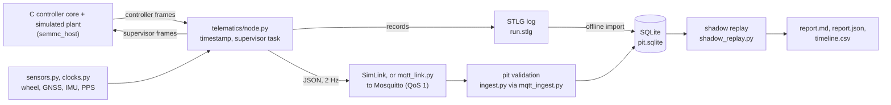

# host: Python software that runs on a computer

`host/` holds the Python side of the project: the code that runs on a laptop, a pit computer or a continuous-integration runner, not on the vehicle's microcontrollers. Nothing in it has run on vehicle hardware. Today it is exercised with the host build of the C motor controller and with synthetic sensor models.

## 1. What this directory contains

| Subdirectory | Contents |
|---|---|
| [`telematics/`](telematics/) | The host model of the telematics unit's firmware (the proposed STM32U575 board on the vehicle CAN bus; CAN: Controller Area Network). It timestamps every controller frame, runs the supervisor task, writes the local log in the STLG format (the unit's block log; "STLG" is the 4-byte marker at the start of every file) and sends a 2 Hz summary over the uplink. The same package has the clock models (GNSS receiver PPS edges, where GNSS is satellite navigation and PPS is the pulse-per-second edge that marks each UTC second, UTC being Coordinated Universal Time), the synthetic wheel, GNSS and IMU sensors (IMU: inertial measurement unit), and the uplink client for MQTT (Message Queuing Telemetry Transport), the publish/subscribe protocol of the uplink, in which messages pass through a broker (Mosquitto here). |
| [`pit/`](pit/) | The pit side: the MQTT ingestion service, validation of every live message before storage, storage in one SQLite database (SQLite: an SQL database held in a single file), the offline import of STLG logs into that database, the pit-side shadow replay of two sensor-consistency monitors, and an energy-per-distance summary of a stored run. The two monitors are R3v, the calibrated-residual monitor with majority-vote attribution that the v2 evaluation selected, and CSIA2, the experimental version 2 adapter built on CSIA (see the `csia_adapter/` row). |
| [`telemetry_adapter/`](telemetry_adapter/) | The supervisor (the energy-strategy side of the CAN contract) and the lockstep co-simulation that connects it to the C controller core, plus an end-to-end scenario runner. |
| [`csia_adapter/`](csia_adapter/) | CSIA adapters and their frozen evaluation harness. CSIA (Cross-Sensor Intelligence Architecture) is a pinned third-party trust core; here it is wrapped as an experimental sensor-consistency diagnostic, run in shadow mode only. The harness also defines R3v and CSIA2. |
| [`logger/`](logger/) | The semmc-log v1 text event format: scenario logs for the C host executable and decoding of the controller's transmitted frames. |
| [`replay/`](replay/) | Replay of a recorded semmc-log through the C core, with requested and accepted torque and the reasons for any difference. |
| [`vcu_bridge/`](vcu_bridge/) | An optional SocketCAN bridge (SocketCAN: the Linux kernel's socket interface to CAN adapters), written as a proposal for a Linux computer on the bus (VCU: vehicle control unit). |

"semmc" is the name of the controller's CAN protocol, defined in [`../protocol/protocol.yaml`](../protocol/protocol.yaml).

## 2. Who works here

* **Telemetry and integration members:** `telematics/`, `pit/ingest.py` and `pit/mqtt_ingest.py`, `telemetry_adapter/`, `logger/`, `replay/`, `vcu_bridge/`. They keep the node model, the log format, the uplink and the pit database consistent with [`../docs/ICD.md`](../docs/ICD.md) (sections 4 and 8 to 10).
* **Data-analysis members:** the pit database, `pit/shadow_replay.py` and `pit/csia_replay.py`, and the reports these produce. The files in `csia_adapter/` are frozen (section 7): they are read and run, not edited.

Changes to the controller itself belong in [`../firmware/`](../firmware/README.md); changes to CAN messages are made in `protocol/protocol.yaml` and regenerated, never in the generated codec.

## 3. Important files

Each table lists the maintained files of one subdirectory. "Inputs" and "Outputs" are what the module consumes and produces when it runs in the chain of section 4.

### 3.1 `telematics/`

| File | What it does in the system | Inputs | Outputs |
|---|---|---|---|
| [`telematics/node.py`](telematics/node.py) | Host model of the telematics unit's tasks. Each received controller frame is timestamped in the telematics clock, handed to the supervisor first (no queue in between) and then queued for the log. A log writer moves queued records into STLG blocks at a bounded rate (queue of 512 records, 4000 records/s); when the queue is full the newest record is dropped and counted, and receive never waits. Every 0.5 s it builds a `sem.telemetry.v2` summary in JSON (JavaScript Object Notation, a text format); while the link is down, messages wait in a 30-message queue (the oldest is dropped and counted) and are sent later, oldest first, with `replayed = true`. Live wheel speed is reported only from a window at most 0.3 s old and only when the circumference and pulses per revolution are configured, otherwise null. `SimLink` is the in-process stand-in for the LTE (cellular) link and broker, with outage windows, latency and payload corruption for tests. | Controller CAN frames (time, identifier, 8 bytes); sensor samples and PPS edges; a link object (`SimLink` or `MqttLink`); a `Supervisor`; `NodeConfig` | STLG records through `stlg.Writer`; the supervisor's frames, returned to the caller for the bus; JSON messages on topic `sem/car/telemetry`; counters (frames received, records logged, queue and storage drops, uplink sent and dropped, queue high water, supervisor overruns) |
| [`telematics/stlg.py`](telematics/stlg.py) | Reference implementation of STLG v1. A file is a header (run metadata as JSON, with a CRC-32 check value; CRC: cyclic redundancy check) followed by 4 KiB blocks, each with its own sequence number, base time and CRC-32, holding records of seven types: CAN frame, PPS edge, GNSS fix, IMU sample, wheel window, counters, event. The writer never blocks: a block that would exceed the storage capacity is not written and its records are counted as storage drops. The reader skips and counts corrupt blocks, resynchronises on the next block marker, counts sequence gaps and reports a truncated last block instead of guessing it. | Records (telematics time in microseconds, type, body) from the node; for reading, an `.stlg` file | The `.stlg` file; on reading, the metadata, the list of records and a `ReadReport` (blocks good and corrupt, gaps, truncated bytes) |
| [`telematics/clocks.py`](telematics/clocks.py) | The three clock domains of the simulation. Controller time is the reference; the telematics clock is modelled with an offset, a 40 ppm drift and a slow wander; PPS edges arrive once per UTC second with jitter, except during GNSS outages. `UtcEstimator` fits UTC against telematics time over the last 8 edges and reports quality `pps` while the last edge is at most 2.5 s old, `holdover` after that (error bound 50 ppm times the age), and `none` before two edges. All values are illustrative, not part data. | Simulation time; PPS edges timestamped in the telematics clock | Telematics time for every timestamp; (UTC, quality, error bound) for each uplink message |
| [`telematics/sensors.py`](telematics/sensors.py) | Synthetic telematics sensors derived from the simulated vehicle speed: three wheel Hall counters (front left, front right, rear driven; 32 pulses per revolution, PROVISIONAL; 0.1 s windows), GNSS speed at 10 Hz and IMU longitudinal acceleration and yaw rate at 100 Hz, with illustrative noise. Faults can be injected: wheel dropout per channel and GNSS outage. | Simulation time, vehicle speed from the controller's simulated plant, GNSS fix state; `SensorConfig` (wheel circumference from the synthetic configuration) | Samples `("wheel", (channel, counts, window_ms))`, `("gnss", ...)`, `("imu", ...)` for `node.on_sensor` |
| [`telematics/mqtt_link.py`](telematics/mqtt_link.py) | Drop-in replacement for `SimLink` that publishes to a real broker with the paho-mqtt client: MQTT 3.1.1, QoS 1 (QoS: quality of service; level 1 means at least once, so the pit may receive a message twice), at most 10 messages held in the client. When the client buffer is full it refuses the message and the node keeps it in its own bounded queue. It records when each sequence number was handed over and when the broker acknowledged it, so a demonstration can tell broker acknowledgement from arrival at the pit. Host model only: the modem's MQTT client firmware is not implemented. | Broker address and port, client identifier; messages from the node | MQTT publications; connect and disconnect events; acknowledged and unacknowledged sequence numbers |

### 3.2 `pit/`

| File | What it does in the system | Inputs | Outputs |
|---|---|---|---|
| [`pit/ingest.py`](pit/ingest.py) | The pit's parse, validate and store step into one SQLite file. `validate_live` checks each live message (schema `sem.telemetry.v1` or `v2`, field types, non-negative sequence and time, a known controller state, value ranges such as bus voltage 0 to 100 V, consistency of the UTC quality, counters, v2 wheel speeds 0 to 60 m/s) and returns the reason for any rejection. `ingest_payload` stores a valid message under the key (run_id, seq), so a re-delivered copy adds nothing; it stores a rejected message with its reason, and records every receipt in table `rx` with its outcome (stored, duplicate, rejected). `import_log` reads an STLG file, maps telematics time to UTC from the logged PPS edges (interpolation between edges, otherwise marked holdover), decodes semmc frames with the generated codec, converts wheel counts to m/s with the circumference and pulses per revolution recorded in the log, and writes rows that a second import does not duplicate. Unknown values stay NULL. | Live payloads (bytes) with receive time and topic; STLG files | SQLite tables `runs`, `live`, `rejected`, `rx`, `records`, `signals`, `imports`; a report per call (stored, duplicate and rejected counts with reasons; blocks, CRC failures and UTC quality counts for an import) |
| [`pit/mqtt_ingest.py`](pit/mqtt_ingest.py) | The pit ingestion service as its own process. It subscribes with QoS 1 and a persistent session (clean session off, fixed client identifier), so the broker queues messages while the service is down; it re-subscribes on every connection. Each message goes, with its MQTT DUP flag (set by the sender on a re-sent message), through `ingest.ingest_payload`, which commits to the database inside the message callback, before the client acknowledges the message: a crash causes a redelivery (counted as a duplicate), not a loss. Connection events go to table `pit_events`. SIGTERM or SIGINT stops it cleanly. | Command line `--db` (required), `--host`, `--port`, `--topic`, `--client-id`; messages from the broker | Rows in the database (as `ingest.py`, plus `pit_events`); a JSON line of outcome counts on exit |
| [`pit/shadow_replay.py`](pit/shadow_replay.py) | Pit-side shadow replay over one stored run. It runs B1 (range, NaN and freshness checks; NaN: not a number), R3v and CSIA2 side by side at 10 Hz, each behind the evaluation's shared 3-tick persistence filter, with the frozen monitor classes, residual threshold and E6 power-balance model read from [`../docs/csia/V2_FREEZE.json`](../docs/csia/V2_FREEZE.json). Only the vehicle parameters (wheel radius, gear ratio, torque constant, freewheel) come from the run. It classifies the data as synthetic or measured from the run metadata, reports per signal the share of ticks with a fresh sample and per relationship the ticks in which it was active, lists attribution episodes, scores them against injected faults when the metadata lists any, and adds "insufficient evidence" notes (synthetic parameters on measured data, flat-road assumption, missing signals, no ground truth). It has no CAN, MQTT or controller interface. | The pit database (`runs` and `signals` tables), a run identifier, `AdapterParams`, torque constant, wheel quantisation step; `V2_FREEZE.json` | A result dictionary; with an output directory, `report.md`, `report.json`, `timeline.csv` |
| [`pit/csia_replay.py`](pit/csia_replay.py) | Rebuilds the monitors' input samples from a run's decoded signals in the telematics clock domain: rotor speed, phase current iq, KCL residual (KCL: Kirchhoff's current law over the three phase currents), DC power, a current reference from accepted torque divided by the torque constant (flagged when the controller reports slew or clamp), the three wheel speeds, GNSS speed with accuracy and satellite count, IMU, and a flat-road grade. The 8-bit frame sequence counters are unwrapped per signal. `build_samples` is the input stage of `shadow_replay.py`; `replay` ticks the frozen v1 adapter at 10 Hz and measures host time per tick and peak Python memory. | The `signals` table, run identifier, `AdapterParams`, torque constant, wheel quantisation step | A list of (time, signal, sample); from `replay`, the v1 advisory timeline (suspects, ambiguity, observability, trust) and runtime figures, used for the host demonstration's `csia_timeline.csv` |
| [`pit/energy.py`](pit/energy.py) | Energy per distance for one stored run and one wheel channel. Energy is the change of the controller's own energy counter (`ctrl_energy.energy_J`) over the run, converted to Wh; distance is the sum of wheel speed times the counting window; the result is Wh/km at the controller input, not the joulemeter's figure. It reports what is missing instead of filling it in: too few energy samples, no wheel samples or no counting window in the metadata give no result; energy gaps and empty wheel windows are reported as lower bounds. `compare_channels` flags a wheel channel whose distance is more than 2 % shorter than the longest (missed pulses or a dropout). | The `signals` table (`energy_J`, `energy_gap_s`, the wheel channel), run identifier, wheel counting window from the run metadata | A summary dictionary per channel (energy, distance, Wh/km, gap time, notes); cross-check notes. `tools/run_pit_replay.py` writes them to `energy.json` |

### 3.3 `telemetry_adapter/`

| File | What it does in the system | Inputs | Outputs |
|---|---|---|---|
| [`telemetry_adapter/supervisor.py`](telemetry_adapter/supervisor.py) | The supervisor. It announces a session (`sup_hello`) and sends nothing with authority until the controller echoes it; then it sends its bounds (`sup_limits`) every 0.1 s and a torque request (`sup_torque_req`) every 0.02 s (50 Hz, PROVISIONAL), stamped with its own clock. It accepts a speed measurement only when the `ctrl_motion` sequence counter advances, so a re-sent or older frame does not renew it. When the speed is reported invalid or is older than 0.05 s, it requests zero torque with coast instead of calling the policy. It handshakes again after a controller reboot (changed `boot_id`). The protocol has no message for arming, mode selection, fault reset or PWM (pulse-width modulation of the motor bridge), so the supervisor cannot send one. Two test policies: a bounded proportional speed hold and a hysteresis pulse-and-coast. | Decoded controller frames (`ctrl_session`, `ctrl_status`, `ctrl_motion`, `ctrl_cmd_trace`, `ctrl_energy`) with local receive time; `SupervisorConfig`; a policy function | CAN frames encoded with the generated codec; a log entry per request (time, torque, coast, reason: policy, `telemetry_stale`, `telemetry_invalid`) |
| [`telemetry_adapter/cosim.py`](telemetry_adapter/cosim.py) | Lockstep co-simulation with the C controller core. It starts `semmc_host --interactive` from the C host build, writes events to its standard input (driver inputs, faults, supervisor frames encoded by the Python codec) followed by `STEP <t>`, and reads back the controller's transmitted frames and one state line. The C side decodes with the generated C codec, so both codecs run every step. | Path to `semmc_host`, the calibration blob (`build/cal/synthetic.bin`), semmc-log events | A `StepResult` per step (frames, state, requested and accepted torque, reason mask, speed, distance, plant energy, faults, session tag); the CSV and frame log written by `semmc_host`; its summary text on close |
| [`telemetry_adapter/e2e.py`](telemetry_adapter/e2e.py) | End-to-end synthetic scenario on the co-simulation with the synthetic configuration: arm at 0.1 s, ECO selected at 0.3 s (ECO: the controller's supervised assist mode, state `ECO_ASSIST`), speed hold at 6 m/s unless another policy is given, supervisor off at 20 s; optional per-step hook and injected `csia_advisory` frames. Used by the end-to-end, fault-injection and CSIA shadow tests and by `tools/run_policy_comparison.py`. | `Scenario`, C build directory, output directory; `config/vehicle.synthetic.yaml` | `RunResult` (step results, supervisor, decoded frames, CSV rows, summary); `e2e.csv` and `e2e_tx.log` in the output directory |

### 3.4 `csia_adapter/` (all frozen, section 7)

| File | What it does in the system | Inputs | Outputs |
|---|---|---|---|
| [`csia_adapter/adapter.py`](csia_adapter/adapter.py) | The v1 vehicle adapter. It wraps the pinned CSIA `TrustCore` (version 0.8.0) with relationships between sensor nodes: E1 rotor against driven wheel (only while the freewheel transmits torque), E2 left against right wheel corrected for yaw, E3a and E3b GNSS against each front wheel, E4 IMU acceleration against wheel acceleration and grade, E6 DC power balance, E7 GNSS against driven wheel, and a phase-current self-consistency check. Freshness, active evidence, observability, trust and monitor health are reported separately; a failing relationship is attributed to one of its two sensors only when the evidence singles it out (the other end corroborated by another relationship, or this sensor failing in more relationships) and its auxiliary inputs are trustworthy; otherwise it is reported as ambiguous. `restriction_permitted()` always returns False. | Samples per signal (value, uncertainty, source time, clock domain, receive time, sequence, session, flags); `AdapterParams`; the pinned core in `.deps/csia-trust-layer` (or `SEMMC_CSIA_PATH`) | An `AdvisoryState` per 0.1 s tick; field values for the `csia_advisory` CAN message |
| [`csia_adapter/adapter_v2.py`](csia_adapter/adapter_v2.py) | The v2 adapter (CSIA2): v1 with one relationship changed. E6 interpolates iq and rotor speed to the time of each DC power sample and expects copper, switching and fixed losses (`1.5 R iq^2 + c_sw abs(iq) + P0`); with a freewheel, phase current becomes an auxiliary input of E1. `calibrate_e6` fits R, c_sw and P0 by least squares on fault-free development data. | Samples; `AdapterParams`; `E6Model` (frozen values in `V2_FREEZE.json`) | `AdvisoryState` per tick; from `calibrate_e6`, a model and a fit report |
| [`csia_adapter/baselines.py`](csia_adapter/baselines.py) | Comparison monitors: B1 range, NaN and freshness checks per signal; B2 fixed-threshold pairwise residuals with a debounce counter and no regime gating. | Samples | Alarm lists per tick |
| [`csia_adapter/synthetic.py`](csia_adapter/synthetic.py) | Synthetic development scenarios (seed 7, 120 s): normal events that must not count as faults (start slip, freewheel coasting, corners, grade, GNSS degradation) with faults injected on top; `params()` gives the synthetic adapter parameters; `run()` ticks an adapter at 10 Hz. | `Scenario` with faults | (receive time, signal, sample) streams; adapter states |
| [`csia_adapter/eval_set.py`](csia_adapter/eval_set.py) | v1 held-out scenario generator: 24 fault-free runs of 300 s (seeds 1000 to 1023) and 14 fault kinds times 5 runs of 240 s (seeds from 2000), with randomised drive profiles and fault onsets and magnitudes; same sensor models as `synthetic.py`. | Seed, duration, fault kind | Scenarios and sample streams |
| [`csia_adapter/eval_set_v2.py`](csia_adapter/eval_set_v2.py) | v2 generator: DC power with copper loss and temperature-dependent resistance, switching and fixed losses at 10 Hz, and speed-hold segments. Development seeds 3000 to 3007 and from 3100; evaluation seeds 6000 to 6023 and from 7000, generated only after the freeze. | Seed, duration, fault kind | Development and evaluation scenario sets; sample streams |
| [`csia_adapter/evaluation.py`](csia_adapter/evaluation.py) | v1 evaluation harness: monitors B1, V0 to V3, V3v, CSIA, TRUST and B1+CSIA on identical streams, threshold calibration on the development run, and per-scenario metrics (false-alarm episodes per hour, detection, attribution, misattribution, latency, unobservable time). | Sample streams and scenarios | Per-tick monitor outputs and scores, consumed by `tools/run_csia_evaluation.py` |
| [`csia_adapter/evaluation_v2.py`](csia_adapter/evaluation_v2.py) | v2 evaluation harness: one shared 3-tick `Debounce` around every monitor; monitors B1, R3, R3v (R3 plus majority-vote attribution), CSIA1, CSIA2, TRUST2 and B1+CSIA2; calibration of the residual and trust thresholds on the development scenarios; host CPU time and peak memory. | Sample streams, `E6Model`, thresholds | Per-tick outputs, timing and calibration, consumed by `tools/run_csia_evaluation_v2.py` and `pit/shadow_replay.py` |

### 3.5 `logger/`, `replay/`, `vcu_bridge/`

| File | What it does in the system | Inputs | Outputs |
|---|---|---|---|
| [`logger/semmc_log.py`](logger/semmc_log.py) | semmc-log v1: a text log with one event per line, `<t_us> <KIND> <payload>`, after the header `# semmc-log v1`, in the controller's local time. It builds scenario logs that `semmc_host` replays (CAN, IO and key=value events) and decodes the controller's transmitted frames with the generated Python codec. | Events built in Python, or a log file | Log files; decoded (time, message name, values, decode status) tuples |
| [`replay/replay.py`](replay/replay.py) | Command-line replay of a recorded semmc-log through the C core. By default the simulated plant is off and measured quantities come from the log's MEAS lines, as a vehicle log would supply them. It decodes the controller's frames and tabulates requested against accepted torque with decoded reason names (for example `SLEW`, `CLAMP_TORQUE`, `BRAKE_OVERRIDE`), and prints the state transitions. | A semmc-log file; `--cal` (default `build/cal/synthetic.bin`); `build/semmc_host`; `--plant`, `--out` | `OUT/replay.csv`, `OUT/replay_tx.log`, `OUT/commands.csv`; a summary on standard output |
| [`vcu_bridge/semmc_socketcan.py`](vcu_bridge/semmc_socketcan.py) | Optional SocketCAN adapter (proposal) for a pit or bench computer with a USB-CAN adapter. It passes only the 64-identifier semmc block (its base, a multiple of 0x40, must equal the controller's `supervision.can_id_base`), translates bus identifiers to protocol numbers, decodes classic frames with the generated codec, ignores CAN FD (flexible data rate) and extended frames, and sends supervisor frames as classic 8-byte frames. Written against a reference project's bus, not the team's; not run on any vehicle. The socket functions need a Linux CAN interface and are not covered by tests. | Raw SocketCAN frames; the block base; message name and values to send | Decoded message dictionaries; frames on the socket |

## 4. Data flow



1. **Controller frames.** `tools/run_host_demo.py` (and `tools/run_mqtt_demo.py`, which reuses its chain) steps the C controller every 10 ms through `telemetry_adapter/cosim.py`. Each step returns the frames the controller transmitted.
2. **Node.** `node.on_can` timestamps each frame, gives it to the supervisor and queues a log record; sensor samples and PPS edges enter the same node. The supervisor's frames are sent to the controller at the next step, and are logged as well.
3. **STLG log and uplink.** `node.service` moves queued records into STLG blocks and, every 0.5 s, hands one JSON summary to the link: `SimLink` in the host demonstration, `MqttLink` and a real broker in the MQTT demonstration.
4. **Pit validation.** Each live message is validated before storage (`ingest.ingest_payload`, called by `mqtt_ingest.py` or, for the simulated broker, by `ingest_live`). Valid messages go to `live`, rejections to `rejected`, every receipt to `rx`.
5. **SQLite and offline import.** After the run, `ingest.import_log` reads `run.stlg` into `runs`, `records` and `signals` of the same database. The log is the complete record; the live path is a summary and can have gaps, which the sequence numbers make visible.
6. **Shadow replay report.** `shadow_replay.run` (inside both demonstrations, or through `tools/run_pit_replay.py`) reads the run's `signals`, which come from the imported log only, not from the live summaries, and writes the report. `tools/run_pit_replay.py` also writes the energy-per-distance summary of `pit/energy.py` (`energy.json`) from the same signals.

## 5. Dependencies on other directories

* **Generated protocol codec:** [`../protocol/generated/semmc_protocol.py`](../protocol/generated/semmc_protocol.py), generated from `protocol/protocol.yaml` by `tools/gen_protocol.py`. Used by the node, the supervisor, the pit ingestion, the semmc-log decoder and the SocketCAN bridge. The C host executable uses the C codec generated from the same file.
* **Firmware host build:** `build/semmc_host` and `build/cal/synthetic.bin`, from `cmake -S firmware -B build -G Ninja && cmake --build build` (see [`../firmware/README.md`](../firmware/README.md)). `telemetry_adapter/cosim.py` runs it, and through it `e2e.py`, both demonstrations and the tests; `replay/replay.py` runs it too.
* **Configuration:** [`../config/vehicle.synthetic.yaml`](../config/vehicle.synthetic.yaml) (read with `tools/config_tool.py`) supplies the wheel circumference, gear ratio, torque limit and torque constant (1.5 times pole pairs times flux linkage) to `e2e.py`, `tools/run_host_demo.py` and `tools/run_pit_replay.py`. The demonstrations record its SHA-256 hash in the log metadata; `run_pit_replay.py` compares it. See [`../config/README.md`](../config/README.md).
* **CSIA freeze manifest:** [`../docs/csia/V2_FREEZE.json`](../docs/csia/V2_FREEZE.json) gives `pit/shadow_replay.py` the frozen residual threshold and E6 model, and lists the frozen files (section 7).
* **CSIA core:** pinned by [`../third_party/csia-trust-layer.lock`](../third_party/csia-trust-layer.lock) (version 0.8.0) and fetched into `.deps/` by `python3 tools/fetch_csia.py`; `csia_adapter/adapter.py` imports it from there. The lock file records its licence as proprietary, for evaluation and internal assessment only.
* **Tools:** `tools/config_tool.py` (YAML loading), `tools/mqtt_broker.py` (starts a local Mosquitto for the MQTT demonstration and tests); the drivers in [`../tools/README.md`](../tools/README.md), section 1.4.
* **Python packages** ([`../requirements.txt`](../requirements.txt)): numpy, paho-mqtt (`mqtt_link.py`, `mqtt_ingest.py`), PyYAML; `sqlite3` is in the standard library.

## 6. How to run and test

Run from the repository root with Python 3.11 or newer.

```sh
python3 -m pip install -r requirements.txt
python3 tools/fetch_csia.py                       # pinned CSIA core into .deps/
cmake -S firmware -B build -G Ninja && cmake --build build
```

| Command | What it does |
|---|---|
| `python3 tools/run_host_demo.py --out build/host_demo` | The whole chain of section 4 with the simulated link (flash stall, supervisor stall, LTE outage, GNSS outage, wheel-sensor fault, braking, two corrupted messages). Prints one `DEMO` line per check (10 checks) and exits 1 if any fails. Writes `run.stlg`, `controller.csv`, `controller_tx.log`, `pit.sqlite`, `summary.json`, `summary.md`, `csia_timeline.csv` and `pit_replay/`. About 20 s. |
| `python3 tools/run_mqtt_demo.py --out build/mqtt_demo` | The same chain through a real local Mosquitto broker and a separate pit service process, with a killed broker, a killed pit service, malformed and duplicate messages. Needs a Mosquitto binary: [`../docs/MQTT_SETUP.md`](../docs/MQTT_SETUP.md). Prints one `MQTT` line per check (12 checks); exits 2 when no broker binary is found. It deletes its `--out` directory first. About one minute at the default pace. |
| `python3 tools/run_pit_replay.py --db build/host_demo/pit.sqlite --run HOSTSIM-0001 --out build/pit_replay` | Shadow replay of B1, R3v and CSIA2 over the run stored by the host demonstration, then the energy summary per wheel channel. Writes `report.md`, `report.json`, `timeline.csv` and `energy.json`. Exit 0 when a report was written, 2 when the run is not in the database. Notes about the configuration (hash differs from the one the run recorded, counting window missing from the metadata) are written into the report's insufficient-evidence list and printed. |
| `python3 -m host.pit.mqtt_ingest --port 1883 --db build/pit.sqlite` | The pit service alone, against a long-running broker. Ctrl-C stops it. |
| `python3 host/replay/replay.py tests/simulation/replay_sample.semmc.log --out build/replay` | Replay of the synthetic recorded sample through the C core. |

Tests (`pytest`; the `build_dir` fixture builds the C host build if it is missing, in `SEMMC_BUILD_DIR` when that is set, otherwise `build/`):

```sh
python3 -m pytest -rs \
  tests/integration/test_host_demo.py tests/integration/test_mqtt_pipeline.py \
  tests/integration/test_shadow_replay.py tests/integration/test_pit_energy.py \
  tests/integration/test_supervisor.py \
  tests/integration/test_end_to_end.py tests/integration/test_vcu_bridge.py \
  tests/integration/test_math_spec.py tests/simulation/test_replay.py \
  tests/fault_injection/test_csia_adapter.py tests/fault_injection/test_fault_injection.py \
  tests/fault_injection/test_csia_freeze.py tests/fault_injection/test_csia_v2_freeze.py
```

| Test file | Covers |
|---|---|
| `tests/integration/test_host_demo.py` | The full host demonstration once; STLG round trip, corrupt and truncated blocks, full storage; flash stall; bounded uplink backlog; UTC estimator; live validation and de-duplication |
| `tests/integration/test_mqtt_pipeline.py` | Validation rules, wheel speed in v2 messages, the `rx` record of every receipt, refused messages; with a broker, persistent session across a broker crash and the MQTT demonstration. Broker tests are skipped without Mosquitto, or fail when `SEMMC_REQUIRE_MQTT=1` (as in continuous integration) |
| `tests/integration/test_shadow_replay.py` | Data class from run metadata, insufficient-evidence notes, the missing-run exit code, and the absence of any CAN, MQTT or controller import in the replay modules |
| `tests/integration/test_pit_energy.py` | Energy-per-distance formulas, the worked example in the root README, missing-data notes, the wheel-channel cross-check and `energy.json` from `tools/run_pit_replay.py` |
| `tests/integration/test_supervisor.py` | Stale, duplicated and invalid speed; pulse-and-coast hysteresis |
| `tests/integration/test_end_to_end.py`, `tests/fault_injection/test_fault_injection.py` | Co-simulation through both codecs and the C core; fault injection through semmc-log scenarios |
| `tests/simulation/test_replay.py` | Replay of `tests/simulation/replay_sample.semmc.log` |
| `tests/fault_injection/test_csia_adapter.py` | CSIA v1 adapter behaviour on synthetic scenarios; shadow mode does not change controller commands |
| `tests/fault_injection/test_csia_freeze.py`, `tests/fault_injection/test_csia_v2_freeze.py` | SHA-256 hashes of the frozen files; evaluation seeds disjoint from development seeds |
| `tests/integration/test_vcu_bridge.py`, `tests/integration/test_math_spec.py` | SocketCAN packing, filtering and decoding; the E6 and UTC examples of `docs/MATH_SPEC.md` |

On 2026-10-17, with a local Mosquitto 2.0.18, these 13 files gave 100 passed, none skipped; both demonstrations passed all their checks.

## 7. Frozen files and generated outputs

**Frozen (do not edit).** Every Python file in `csia_adapter/` except `__init__.py` is listed, with its SHA-256 hash, under `frozen_files_sha256` in [`../docs/csia/V2_FREEZE.json`](../docs/csia/V2_FREEZE.json): `adapter.py`, `adapter_v2.py`, `baselines.py`, `eval_set.py`, `eval_set_v2.py`, `evaluation.py`, `evaluation_v2.py`, `synthetic.py`. The same list holds `docs/csia/EVALUATION_PROTOCOL_v2.md`, `third_party/csia-trust-layer.lock`, `tools/run_csia_evaluation.py` and `tools/run_csia_evaluation_v2.py`. `tests/fault_injection/test_csia_v2_freeze.py` fails if any hash differs; the v1 subset is also checked against [`../docs/csia/DEV_SET_FREEZE.json`](../docs/csia/DEV_SET_FREEZE.json) by `tests/fault_injection/test_csia_freeze.py`. A change to a frozen file has to be recorded, with its reason and the before and after results, in [`../docs/csia/EVALUATION_PROTOCOL_v2.md`](../docs/csia/EVALUATION_PROTOCOL_v2.md) section 7; a changed monitor needs a new freeze and a new, untouched evaluation set ([`../docs/csia/EVALUATION_RESULTS_v2.md`](../docs/csia/EVALUATION_RESULTS_v2.md), section 4). The rest of `host/`, including `pit/shadow_replay.py` and `pit/csia_replay.py` (which use the frozen classes), is not frozen.

**Generated (do not edit by hand).**
* No source file in `host/` is generated. `protocol/generated/semmc_protocol.py`, which `host/` imports, is generated.
* Run outputs: everything the demonstrations and the replay write under their `--out` directories (`run.stlg`, `pit.sqlite`, CSV files, `summary.*`, `report.*`, `timeline.csv`, `energy.json`, the broker's files). `build/` is not tracked.
* Committed samples of those outputs: `docs/generated/host_demo/` and `docs/generated/mqtt_demo/`, written with `--samples DIR`; rerun the demonstration to refresh them.
* `tests/simulation/replay_sample.semmc.log` is generated by `tools/make_replay_sample.py`.

## 8. Current limitations

* **Host model only.** `telematics/` models the structure of the telematics firmware; the STM32U575 firmware itself is not written ([`../docs/TELEMETRY_EMBEDDED_PORT.md`](../docs/TELEMETRY_EMBEDDED_PORT.md)). Rates and capacities (queue sizes, writer rate, 2 Hz uplink) are configuration values chosen to exercise the behaviour, not measurements.
* **No real LTE modem.** The simulated link is an in-process list with outage windows. With MQTT, the broker is a local Mosquitto on loopback without authentication or TLS (Transport Layer Security, the encryption a networked broker would need), and an outage is a killed broker process.
* **Synthetic sensors and plant.** Every sensor sample comes from `sensors.py` and the C simulated plant; clock offsets, drift and noise are illustrative. Wheel pulses per revolution (32) and the channel assignment are PROVISIONAL, and the replay assumes a flat road.
* **The supervisor is a test policy.** Speed hold and pulse-and-coast exercise the CAN contract; they are not the team's energy strategy. Its 50 Hz rate and the controller's 100 ms timeout are provisional and simulation-only.
* **CSIA is experimental and shadow-only.** It never commands torque: `restriction_permitted()` returns False, and the shadow replay has no CAN, MQTT or controller interface ([`../docs/decisions/ADR-0008-csia-shadow-mode.md`](../docs/decisions/ADR-0008-csia-shadow-mode.md)). R3v is the selected monitor. The frozen v2 evaluation, on synthetic data, found that CSIA2 did not meet its pre-registered criterion against R3v: it attributed 48 of 70 fault scenarios correctly against 34 for R3v, but named a wrong cause in 4 scenarios against 0, where the rule allowed at most 1 more ([`../docs/csia/EVALUATION_RESULTS_v2.md`](../docs/csia/EVALUATION_RESULTS_v2.md)). The E6 model has to be refitted on bench data of the real motor and controller before any residual result is used on the vehicle.
* **The frozen v1 adapter does not fit the host plant.** Its E6 power balance fails outside the injected fault window in the host demonstration (in 507 ticks outside that window, of 1200 ticks in the run made for this README); the demonstration reports this in `summary.md` and a test requires it to be reported.
* **SocketCAN bridge.** A proposal for a Linux computer; not run on any vehicle bus, and its socket functions are untested.
